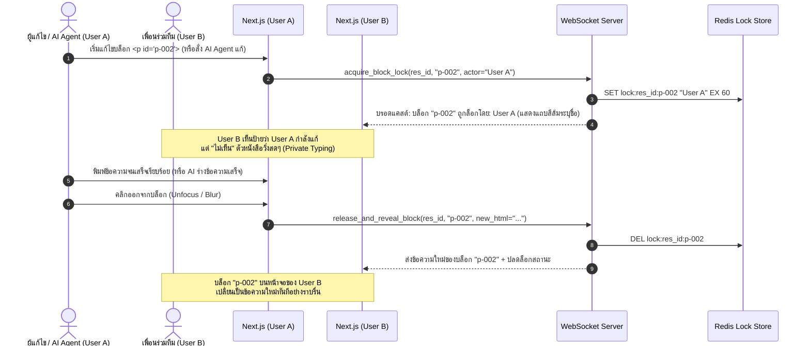
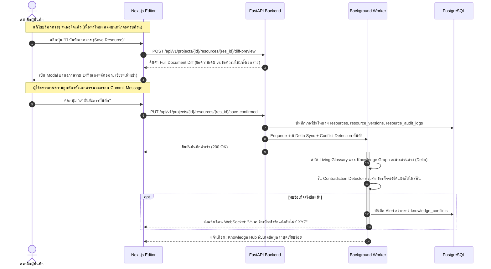
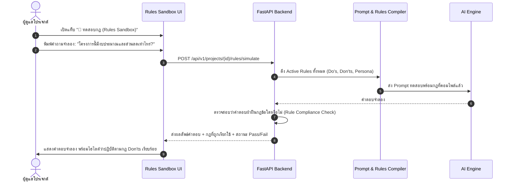

# User Journey & Interaction Workflows 🗺️

เอกสารฉบับนี้อธิบายเส้นทางประสบการณ์ผู้ใช้ (User Journey) และแผนภาพลำดับขั้นตอนการทำงาน (Sequence & Flowcharts) ฉบับปรับปรุง เพื่อรองรับ **Block-Level Exclusive Locking ระบุตัวตนผู้ล็อก (Private Typing -> Broadcast เมื่อเสร็จ)**, **Whole-Document Save พร้อม Diff Modal**, และ **Save-Triggered Delta Sync & Conflict Detector**

---

## 1. ลำดับการล็อกระดับบล็อก และการแสดงผลเมื่อพิมพ์เสร็จ (Block Lock & Reveal Flow)



---

## 2. ลำดับการบันทึกเอกสารทั้งฉบับ และการซิงค์ความรู้ (Save Resource & Delta Sync Flow)



---

## 3. ลำดับการทำงานของ Contradiction & Conflict Detector

```mermaid
flowchart TD
    A[Background Job เริ่มประมวลผลหลังบันทึกไฟล์ใหม่] --> B[สกัดข้อเท็จจริงสำคัญ Claims จากเนื้อหาใหม่]
    B --> C[ค้นหา Chunks ที่เกี่ยวข้องในเอกสารอื่นๆ ด้วย Vector Similarity]
    C --> D[ส่งข้อเท็จจริงคู่ขนานเข้า LLM Cross-Verification]
    
    D --> E{ข้อมูลตรงกันหรือขัดแย้งกัน?}
    E -- ข้อมูลสอดคล้องกัน -- --> F[ผ่าน: อัปเดต Knowledge Base ตามปกติ]
    E -- ข้อมูลขัดแย้งกัน -- --> G[สร้าง Record ในตาราง knowledge_conflicts]
    
    G --> H[แสดงป้ายเตือนใน Knowledge Hub: Conflict Alert]
    H --> I[แสดง: ชื่อ 2 ไฟล์ที่ขัดแย้ง + ข้อความที่ค้านกัน]
    I --> J[ทีมงานตรวจสอบและคลิก 'ทำเครื่องหมายว่ารับทราบ/แก้ไขแล้ว']
```

---

## 4. ลำดับการทดสอบกฎ AI ใน Rules Simulator (Rules Sandbox Flow)


