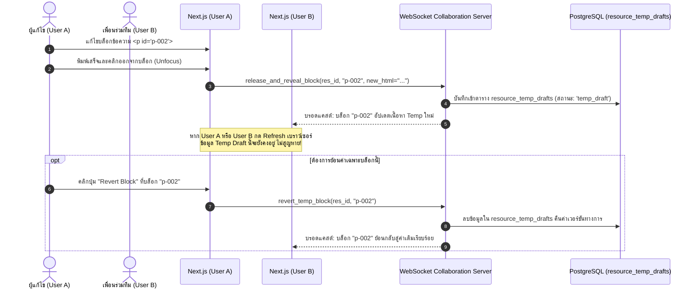
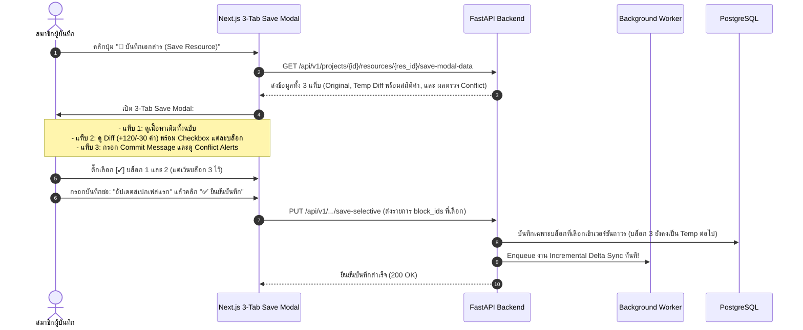

# User Journey & Interaction Workflows 🗺️

เอกสารฉบับนี้อธิบายเส้นทางประสบการณ์ผู้ใช้ (User Journey) และแผนภาพลำดับขั้นตอนการทำงาน (Sequence & Flowcharts) ฉบับปรับปรุง เพื่อรองรับ **Shared Temp Draft State**, **3-Tab Save Modal พร้อม Selective Staging**, **Conflict Detection (On Generate & On Save)**, และ **Canonical Term Standardization**

---

## 1. ลำดับการแก้ไขแบบ Shared Temp State (รีเฟรชไม่หาย ทุกคนเห็นตรงกัน)



---

## 2. ลำดับการบันทึกเอกสารด้วย 3-Tab Save Modal พร้อม Selective Staging



---

## 3. ลำดับการตรวจจับ Conflict 2 จังหวะ (On Generate & On Save)

```mermaid
flowchart TD
    Trigger1[1. ผู้ใช้สั่ง AI สร้าง Resource ใหม่ใน Chat] --> Check1[AI รัน Cross-Source Fact Checker]
    Trigger2[2. ผู้ใช้กดปุ่ม Save Resource] --> Check2[AI รัน Cross-Source Fact Checker]

    Check1 --> Analyze[วิเคราะห์ Claims เทียบกับไฟล์อื่นๆ ในโปรเจกต์]
    Check2 --> Analyze

    Analyze --> Result{พบข้อเท็จจริงขัดแย้งหรือไม่?}
    
    Result -- พบความขัดแย้งในขั้นตอน Generate -- --> Alert1[แสดงหน้าต่างเตือนในแชท: 'เนื้อหาที่สร้างขัดแย้งกับไฟล์ B' ก่อนกดเพิ่มเข้าคลัง]
    Result -- พบความขัดแย้งในขั้นตอน Save -- --> Alert2[แสดงในการ์ดแท็บที่ 3: 'หมายเหตุ & ข้อขัดแย้ง' ใน Save Modal ทันที]
    Result -- ไม่พบข้อขัดแย้ง -- --> Pass[ผ่าน: บันทึกได้ราบรื่น ไร้ข้อติดขัด]
```
