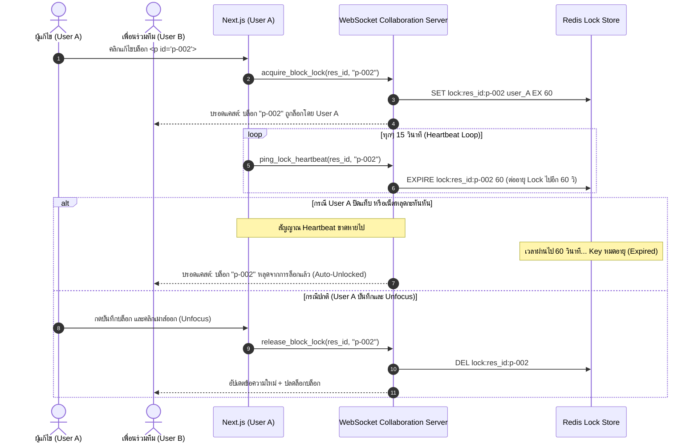
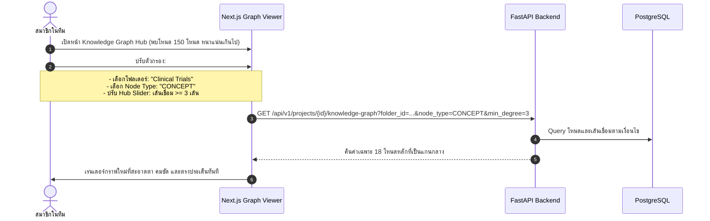

# User Journey & Interaction Workflows 🗺️

เอกสารฉบับนี้อธิบายเส้นทางประสบการณ์ผู้ใช้ (User Journey) และแผนภาพลำดับขั้นตอนการทำงาน (Sequence & Flowcharts) ฉบับปรับปรุง เพื่อรองรับ **Block-Level Locking พร้อม Heartbeat Timeout**, **Incremental Delta Knowledge Sync**, และ **Smart Knowledge Graph Filters**

---

## 1. ลำดับการล็อกระดับบล็อก และกลไก Heartbeat Timeout (Lock Heartbeat Flow)



---

## 2. ลำดับการซิงค์ความรู้แบบประหยัด Token: Incremental Delta Sync

```mermaid
flowchart TD
    A[ผู้ใช้คลิกปุ่ม '⚡ อัปเดต Knowledge'] --> B[ระบบดึงรายชื่อไฟล์ใน modified_resources]
    B --> C[เปรียบเทียบ Diff กับเวอร์ชันก่อนหน้า: สกัด Added Text & Deleted Text]
    
    C --> D[1. สกัดเฉพาะ Added Text]
    D --> E[ส่งเฉพาะข้อความที่เพิ่มเข้าสู่ LLM เพื่อดึง Glossary & Graph Nodes ใหม่]
    E --> F[Upsert เข้าตาราง project_glossaries และ knowledge_graph_nodes]

    C --> G[2. ตรวจสอบ Deleted Text]
    G --> H[ค้นหาคำศัพท์/โหนดที่ข้อความนี้เคยอ้างอิง]
    H --> I{ยังมีเอกสารอื่นอ้างอิงอยู่หรือไม่?}
    I -- มีเอกสารอื่นอ้างอิง -- --> J[คงไว้ตามปกติ]
    I -- ไม่มีใครอ้างอิงแล้ว -- --> K[ปลดการเชื่อมโยง หรือลบออก (Pruning)]

    F --> L[คำนวณ Embeddings เฉพาะ Chunks ที่เปลี่ยนแปลง]
    K --> L
    L --> M[ล้าง modified_resources และตั้ง is_stale = false]
    M --> N[แจ้งเตือน Frontend: การซิงค์เสร็จสิ้น (ใช้ Token น้อยลง 90%+)]
```

---

## 3. ลำดับการใช้งานตัวกรอง Smart Knowledge Graph (Graph Filter Flow)


