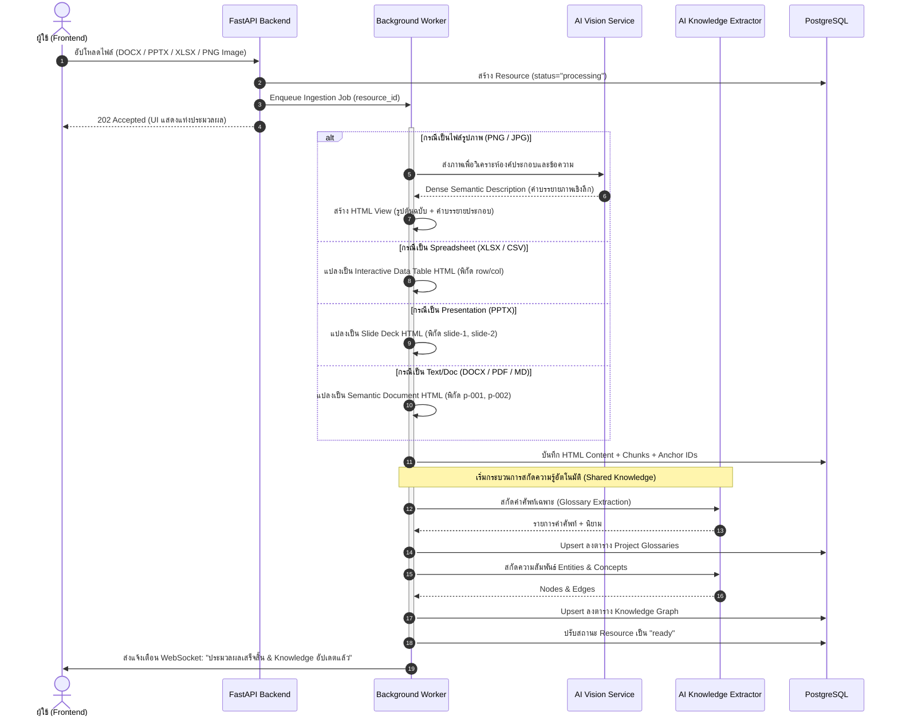
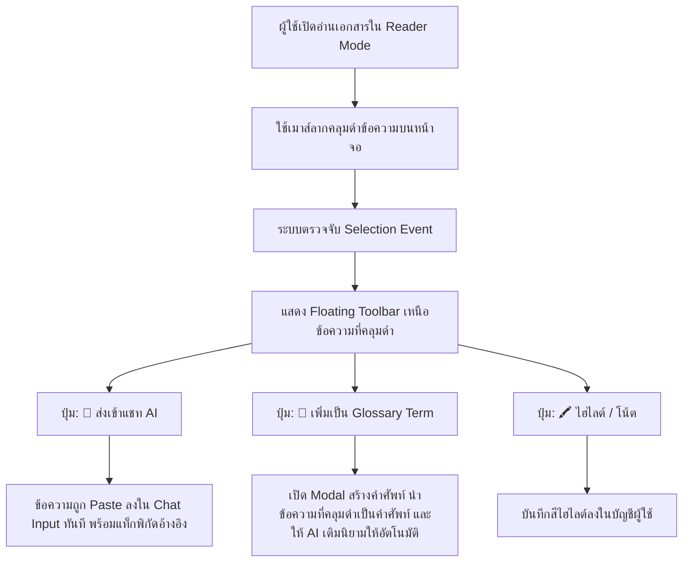
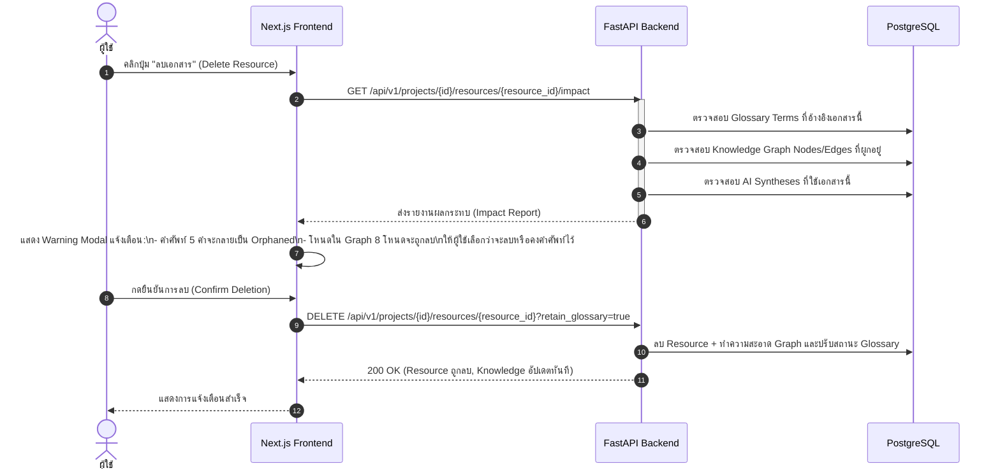
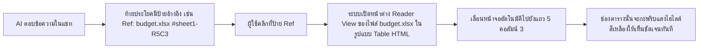

# User Journey & System Interaction Flows 🗺️

เอกสารฉบับนี้อธิบายเส้นทางประสบการณ์ผู้ใช้ (User Journey) และแผนภาพลำดับขั้นตอนการทำงาน (Sequence & Flowcharts) ของระบบ **CogniNest** ที่ครอบคลุมการแปลงข้อมูลหลากฟอร์แมต (Docs, Slides, Sheets, Graphs, Images with AI Vision), เมนูลอยเมื่อคลุมดำข้อความ, ระบบลบ Resource พร้อมวิเคราะห์ผลกระทบ และการทำงานร่วมกันแบบ Shared Knowledge & Private Chat

---

## 1. ผังวงจรชีวิตของระบบ (System Lifecycle Overview)

```
┌────────────────────────────────────────────────────────────────────────┐
│ 1. สร้างโปรเจกต์ใหม่ (เริ่มต้นด้วยความว่างเปล่า)                        │
└───────────────────────────────────┬────────────────────────────────────┘
                                    │
                                    ▼
┌────────────────────────────────────────────────────────────────────────┐
│ 2. นำเข้าไฟล์หลากรูปแบบ (Any Files: DOCX, PDF, PPTX, XLSX, Images...)   │
└───────────────────────────────────┬────────────────────────────────────┘
                                    │
                                    ▼
┌────────────────────────────────────────────────────────────────────────┐
│ 3. Background Job Pipeline ทำงานอัตโนมัติ                              │
│    - แปลงข้อมูลเป็น Semantic HTML (Doc, Slide, Sheet, Graph, Vision)   │
│    - ฝัง Universal Anchor IDs (p-xxx, slide-xx, cell-xx)               │
│    - สกัด Living Glossary + Interactive Knowledge Graph                │
└───────────────────────────────────┬────────────────────────────────────┘
                                    │
                                    ▼
┌────────────────────────────────────────────────────────────────────────┐
│ 4. สมาชิกทีมใช้งานร่วมกันบน Shared Knowledge                           │
│    - อ่านเอกสาร HTML ผ่าน Reader View                                  │
│    - คลุมดำข้อความเพื่อส่งเข้าแชท หรือสร้าง Glossary Term ทันที         │
│    - ดูโหนดสัมพันธ์ใน Knowledge Graph                                   │
└───────────────────────────────────┬────────────────────────────────────┘
                                    │
                                    ▼
┌────────────────────────────────────────────────────────────────────────┐
│ 5. การทำงานกับ AI ส่วนบุคคล (Private 1-User-1-Session)                │
│    - ถามตอบคำถามโดยมี Citation ย้อนกลับไปยังพิกัดต้นทาง                │
│    - สั่ง AI สร้างเอกสารใหม่ แล้วกดบันทึกเข้าสู่โฟลเดอร์ส่วนกลาง       │
└───────────────────────────────────┬────────────────────────────────────┘
                                    │
                                    ▼
┌────────────────────────────────────────────────────────────────────────┐
│ 6. การจัดการและลบข้อมูลอย่างปลอดภัย (Impact-Aware Deletion)            │
│    - คำนวณผลกระทบต่อ Glossary, Graph และ Syntheses ก่อนยืนยันลบ        │
└────────────────────────────────────────────────────────────────────────┘
```

---

## 2. แผนภาพและขั้นตอนการทำงานอย่างละเอียด (Detailed Workflows)

### 2.1 โฟลว์การนำเข้าไฟล์หลากรูปแบบและ AI Vision Ingestion



---

### 2.2 โฟลว์เมนูลอยเมื่อคลุมดำข้อความใน Reader View (Floating Selection Action)



---

### 2.3 โฟลว์การลบ Resource พร้อมวิเคราะห์ผลกระทบ (Impact-Aware Deletion Flow)



---

### 2.4 โฟลว์การอ้างอิงแหล่งที่มาสากล (Universal Citation Navigation)


