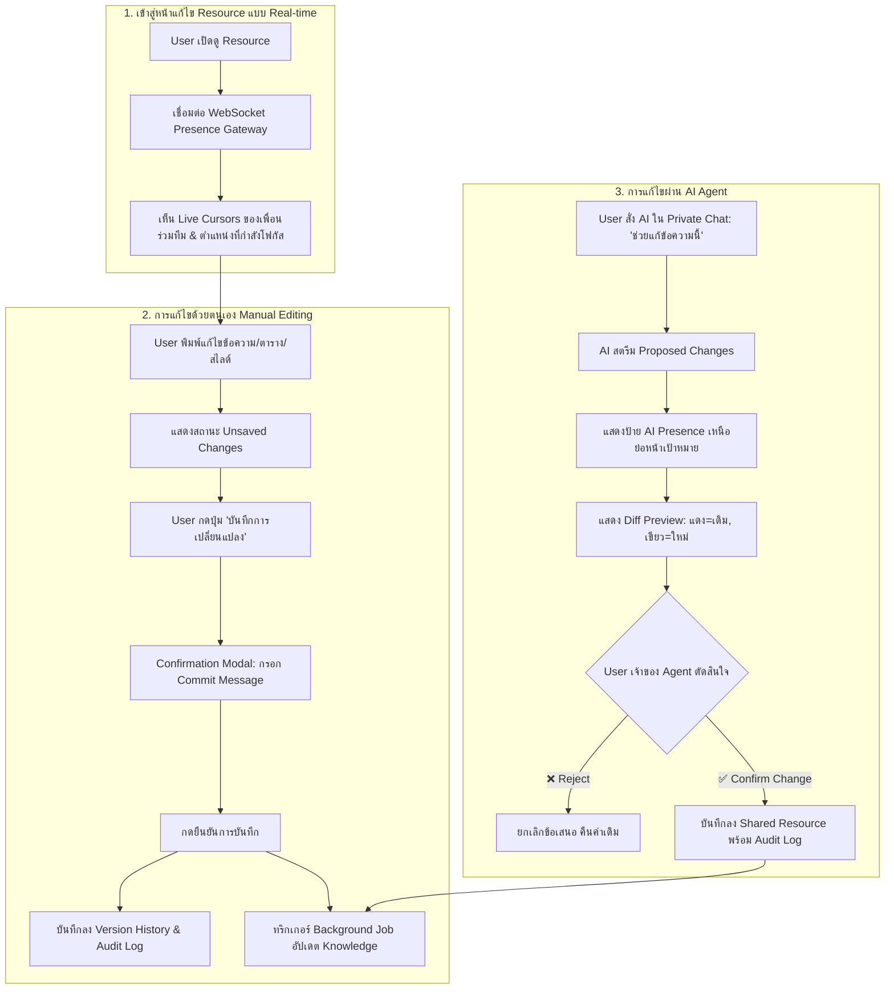
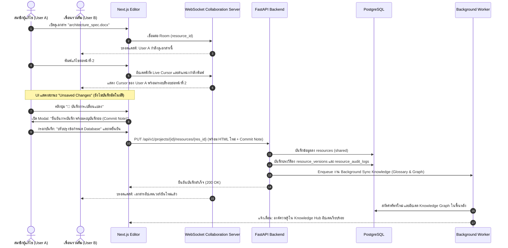
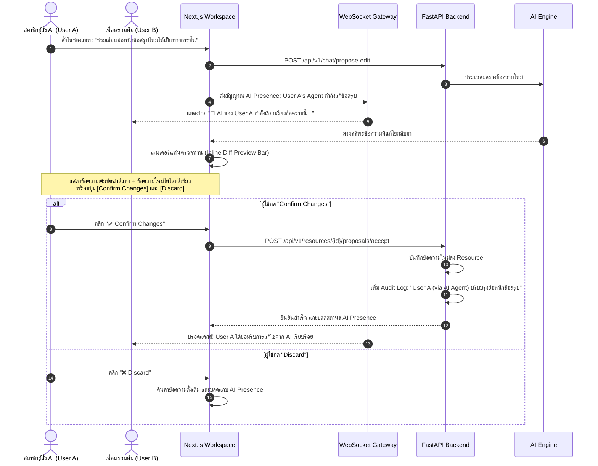
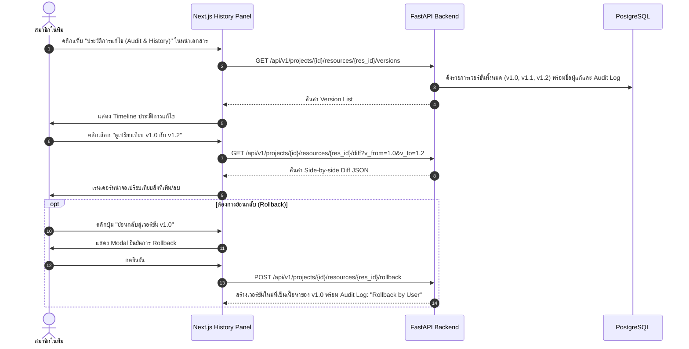

# User Journey & Interaction Workflows 🗺️

เอกสารฉบับนี้อธิบายเส้นทางประสบการณ์ผู้ใช้ (User Journey) และแผนภาพลำดับขั้นตอนการทำงาน (Sequence & Flowcharts) ฉบับปรับปรุง เพื่อรองรับ **In-Place Editable HTML Viewers**, **ระบบกดยืนยันบันทึกแบบ Explicit Save**, **Human-in-the-Loop AI Proposal Review**, **Real-time Multiplayer Collaboration** และ **Full Audit Trail**

---

## 1. ผังรวมขั้นตอนการแก้ไขและการร่วมมือกัน (Collaborative Editing Flow)

---

## 2. ลำดับขั้นตอนการทำงานอย่างละเอียด (Detailed Workflows)

### 2.1 โฟลว์การแก้ไขเอกสารด้วยตนเอง และการกดยืนยันบันทึก (Explicit Save Flow)

---

### 2.2 โฟลว์การตรวจทานการแก้ไขจาก AI Agent (Human-in-the-Loop Review Flow)

---

### 2.3 โฟลว์การดูประวัติการแก้ไขและ Audit Log (Version History & Rollback)

