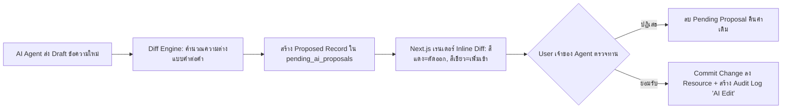

# Technical & System Architecture 🏗️

เอกสารฉบับนี้อธิบายสถาปัตยกรรมทางเทคนิคของระบบ **CogniNest** ฉบับปรับปรุง เพื่อรองรับ **ระบบแก้ไขเอกสารในหน้าเว็บ (In-Place Semantic Editor)**, **Multiplayer Real-time Collaboration (WebSocket / CRDT Presence)**, **AI Agent Presence & Human-in-the-Loop Diff Engine**, และ **สถาปัตยกรรม Audit Log & Version History**

---

## 1. ผังสถาปัตยกรรมทั้งระบบ (Full Real-time Collaborative Architecture)

```
┌────────────────────────────────────────────────────────────────────────┐
│                        CLIENT LAYER (Next.js 15)                       │
│  ┌───────────────────────┬──────────────────────┬───────────────────┐  │
│  │  In-Place WYSIWYG     │  Live Multiplayer    │  AI Presence &    │  │
│  │  Semantic Editor      │  Cursors (Yjs/WS)    │  Diff Review Bar  │  │
│  ├───────────────────────┼──────────────────────┼───────────────────┤  │
│  │  Explicit Save Modal  │  Audit History &     │  Private AI Chat  │  │
│  │  (Commit Message)     │  Diff Viewer Panel   │  (1 User 1 Sess)  │  │
│  └───────────────────────┴──────────────────────┴───────────────────┘  │
└───────────────────────────────────┬────────────────────────────────────┘
                     HTTPS (REST / SSE) │ ▲ WebSocket (Presence & Cursors)
                                        ▼ │
┌────────────────────────────────────────────────────────────────────────┐
│                     BACKEND API LAYER (Python FastAPI)                 │
│  ┌───────────────────────┬──────────────────────┬───────────────────┐  │
│  │ Auth & Multi-tenant   │ Realtime WebSocket   │ Version & Audit   │  │
│  │ (Owner/Editor/Viewer) │ Presence Gateway     │ Manager Service   │  │
│  ├───────────────────────┼──────────────────────┼───────────────────┤  │
│  │ AI Proposal & Diff    │ Explicit Save &      │ Private Chat SSE  │  │
│  │ Review Controller     │ Background Trigger   │ Streaming Service │  │
│  └───────────────────────┴──────────────────────┴───────────────────┘  │
└──────────────────┬────────────────────────────────┬────────────────────┘
                   │                                │ Enqueue Sync Job
                   ▼                                ▼
┌──────────────────────────────────┐ ┌──────────────────────────────────┐
│     DATABASE & VECTOR STORE      │ │       ASYNCHRONOUS WORKER        │
│          (PostgreSQL 16)         │ │         (Celery / Redis)         │
│  ┌─────────────────────────────┐ │ │  ┌─────────────────────────────┐ │
│  │ Shared Resources & Folders  │ │ │  │ Knowledge Sync Pipeline:    │ │
│  ├─────────────────────────────┤ │ │  │ - Re-extract Living Glossary│ │
│  │ Resource Versions & Audits  │ │ │  │ - Update Knowledge Graph    │ │
│  ├─────────────────────────────┤ │ │  │ - Re-embed Modified Chunks  │ │
│  │ Pending AI Proposals        │ │ │  └─────────────────────────────┘ │
│  ├─────────────────────────────┤ │ └──────────────────────────────────┘
│  │ Shared Living Knowledge Hub │ │
│  ├─────────────────────────────┤ │
│  │ Private AI Chat Sessions    │ │
│  └─────────────────────────────┘ │
└──────────────────────────────────┘
```

---

## 2. Real-time Collaboration & Multiplayer Presence Architecture

เพื่อให้ผู้ใช้เห็นตำแหน่งเคอร์เซอร์ของเพื่อนร่วมทีมและสถานะ AI แบบเรียลไทม์:

### 2.1 WebSocket Presence Gateway
* ทุกครั้งที่ผู้ใช้เปิดดู Resource ระบบ Next.js จะเชื่อมต่อ WebSocket เข้าสู่ Channel:
  `ws://api.domain.com/ws/projects/{project_id}/resources/{resource_id}`
* **Payload โครงสร้างข้อมูล Presence:**
  ```json
  {
    "user_id": "uuid-user-a",
    "user_name": "Somchai",
    "user_color": "#4F46E5",
    "cursor": { "anchor_id": "p-014", "offset": 12 },
    "active_element_id": "p-014",
    "ai_agent_status": {
      "is_active": true,
      "target_anchor_id": "p-014",
      "action_description": "กำลังเรียบเรียงข้อความใหม่..."
    }
  }
  ```

### 2.2 Client-Side Collaborative Editor
* ใช้ **Tiptap / ProseMirror** หรือ **Lexical** ร่วมกับส่วนขยาย Collaboration
* เมื่อเพื่อนร่วมทีมเลื่อนเคอร์เซอร์ หรือมี AI Agent กำลังเจนเนอเรตข้อความ ระบบจะวาด Custom Floating Cursor และกรอบสีระบุชื่อผู้ใช้หรือ AI บนหน้าจอทันที

---

## 3. กลไก In-Place Editing & Explicit Save

เพื่อไม่ให้การพิมพ์เล่นหรือข้อความที่ยังไม่สมบูรณ์หลุดเข้าไปในระบบ Knowledge Base:

```
[User พิมพ์แก้ไขบนหน้าจอ]
           │
           ▼
[Local Dirty State (Unsaved Changes)]
- แสดงแถบเตือนสีส้ม "มีข้อมูลที่ยังไม่ได้บันทึก"
- ยังไม่ส่งข้อมูลไปอัปเดต PostgreSQL หรือ RAG Index
           │
           ▼
[User คลิกปุ่ม '💾 บันทึกการเปลี่ยนแปลง']
           │
           ▼
[Modal ยืนยัน: ให้ผู้ใช้กรอก Commit Message]
           │
           ▼
[POST /api/v1/.../save-confirmed]
- บันทึก Snapshot ลงตาราง `resource_versions`
- บันทึกการกระทำลง `resource_audit_logs`
- อัปเดตตาราง `resources`
           │
           ▼
[Enqueue Background Knowledge Sync]
- Worker นำข้อความเวอร์ชันใหม่ไปคำนวณ Chunks & Embeddings ใหม่
- ตรวจสอบคำศัพท์ใหม่เข้า Living Glossary และเชื่อมโยง Knowledge Graph
```

---

## 4. Human-in-the-Loop AI Proposal & Diff Engine

กลไกควบคุมเมื่อสั่งให้ AI แก้ไขเอกสาร:



---

## 5. Audit Trail & Version History Engine

1. **Immutable Version Snapshots:**  
   ทุกครั้งที่มีการบันทึก (ทั้ง Manual Save หรือ AI Confirmed Edit) ระบบจะเก็บ Full HTML Snapshot พร้อม Diff Patch ลงตาราง `resource_versions`
2. **Audit Action Log:**  
   ตาราง `resource_audit_logs` จะเก็บบันทึกว่าใครทำอะไร เมื่อไหร่ เช่น:
   - `Action: MANUAL_EDIT | Actor: Somchai | Note: ปรับราคาในตาราง`
   - `Action: AI_EDIT_CONFIRMED | Actor: Somchai (via AI Agent) | Note: แปลงเป็นภาษาทางการ`
   - `Action: ROLLBACK | Actor: Admin | Note: ย้อนกลับสู่ v1.0`
3. **Audit Exemption Rule (ข้อยกเว้น):**  
   การสนทนาใน Private AI Chat จะไม่ถูกส่งเข้า Audit Logger เพื่อรักษาความเป็นส่วนตัวและเพราะไม่ได้เปลี่ยนแปลงสถานะของ Resource ส่วนรวม
