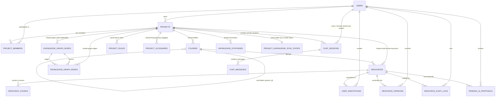

# PostgreSQL Database Schema & Data Models 🗄️

เอกสารฉบับนี้กำหนดโครงสร้างฐานข้อมูลเชิงสัมพันธ์และเวกเตอร์ (Relational & Vector Data Schema) สำหรับ **PostgreSQL 16** พร้อมส่วนขยาย `pgvector` ฉบับปรับปรุง เพื่อรองรับ **Incremental Delta Knowledge Sync**, **Smart Graph Filters (Degree, Verification, Tags)**, **Block-Level Locking**, และ **Full Version History**

---

## 1. ผังความสัมพันธ์ของข้อมูล (Entity-Relationship Diagram: ERD)



---

## 2. นิยามโครงสร้างตาราง (DDL & Table Specifications)

### 2.1 ตารางติดตามสถานะการซิงค์แบบ Incremental Delta Sync

#### `project_knowledge_sync_states`
```sql
CREATE TABLE project_knowledge_sync_states (
    id UUID PRIMARY KEY DEFAULT uuid_generate_v4(),
    project_id UUID UNIQUE NOT NULL REFERENCES projects(id) ON DELETE CASCADE,
    is_stale BOOLEAN DEFAULT FALSE,
    last_synced_at TIMESTAMP WITH TIME ZONE DEFAULT CURRENT_TIMESTAMP,
    modified_resource_ids UUID[] DEFAULT '{}', -- รายการไฟล์ที่ถูกแก้หลังการซิงค์รอบก่อน
    last_synced_versions JSONB DEFAULT '{}'::jsonb, -- เก็บ mapping { "res_id": version_number } เพื่อคำนวณ Delta Diff
    sync_progress_percent INT DEFAULT 100,
    updated_at TIMESTAMP WITH TIME ZONE DEFAULT CURRENT_TIMESTAMP
);

CREATE INDEX idx_sync_state_project ON project_knowledge_sync_states(project_id);
```

---

### 2.2 ตาราง Living Glossary และ Knowledge Graph แบบรองรับ Smart Filters

#### `project_glossaries`
```sql
CREATE TABLE project_glossaries (
    id UUID PRIMARY KEY DEFAULT uuid_generate_v4(),
    project_id UUID NOT NULL REFERENCES projects(id) ON DELETE CASCADE,
    term VARCHAR(150) NOT NULL,
    tag VARCHAR(50) NOT NULL DEFAULT 'General',
    aliases TEXT[] DEFAULT '{}',
    definition TEXT NOT NULL,
    source_resource_ids UUID[] DEFAULT '{}',
    is_ai_generated BOOLEAN DEFAULT TRUE,
    is_verified BOOLEAN DEFAULT FALSE,       -- สำหรับฟิลเตอร์ Verification Status
    created_at TIMESTAMP WITH TIME ZONE DEFAULT CURRENT_TIMESTAMP,
    updated_at TIMESTAMP WITH TIME ZONE DEFAULT CURRENT_TIMESTAMP,
    UNIQUE (project_id, term, tag)
);

CREATE INDEX idx_glossary_term_tag ON project_glossaries(project_id, term, tag);
```

#### `knowledge_graph_nodes`
```sql
CREATE TABLE knowledge_graph_nodes (
    id UUID PRIMARY KEY DEFAULT uuid_generate_v4(),
    project_id UUID NOT NULL REFERENCES projects(id) ON DELETE CASCADE,
    node_key VARCHAR(150) NOT NULL,
    label VARCHAR(200) NOT NULL,
    node_type VARCHAR(50) NOT NULL 
        CHECK (node_type IN ('CONCEPT', 'TECH_ENTITY', 'ORGANIZATION', 'RULE', 'SOURCE_RESOURCE')),
    tag VARCHAR(50) DEFAULT 'General',       -- สำหรับฟิลเตอร์ Domain Tag
    summary TEXT,
    source_resource_ids UUID[] DEFAULT '{}', -- สำหรับฟิลเตอร์ Folder / Resource
    is_verified BOOLEAN DEFAULT FALSE,       -- สำหรับฟิลเตอร์ Verification Status
    metadata_json JSONB DEFAULT '{}'::jsonb,
    created_at TIMESTAMP WITH TIME ZONE DEFAULT CURRENT_TIMESTAMP,
    updated_at TIMESTAMP WITH TIME ZONE DEFAULT CURRENT_TIMESTAMP,
    UNIQUE (project_id, node_key)
);

CREATE INDEX idx_graph_nodes_filter ON knowledge_graph_nodes(project_id, node_type, tag);
```

#### `knowledge_graph_edges`
```sql
CREATE TABLE knowledge_graph_edges (
    id UUID PRIMARY KEY DEFAULT uuid_generate_v4(),
    project_id UUID NOT NULL REFERENCES projects(id) ON DELETE CASCADE,
    source_node_id UUID NOT NULL REFERENCES knowledge_graph_nodes(id) ON DELETE CASCADE,
    target_node_id UUID NOT NULL REFERENCES knowledge_graph_nodes(id) ON DELETE CASCADE,
    relation_type VARCHAR(50) NOT NULL,
    description TEXT,
    weight FLOAT DEFAULT 1.0,
    created_at TIMESTAMP WITH TIME ZONE DEFAULT CURRENT_TIMESTAMP,
    UNIQUE (project_id, source_node_id, target_node_id, relation_type)
);

CREATE INDEX idx_graph_edges_project ON knowledge_graph_edges(project_id);
```

---

### 2.3 ตารางโครงสร้างหลัก (Resources, Versions & Audit Logs)

```sql
CREATE EXTENSION IF NOT EXISTS "uuid-ossp";
CREATE EXTENSION IF NOT EXISTS "vector";
CREATE EXTENSION IF NOT EXISTS "pg_trgm";

CREATE TABLE users (
    id UUID PRIMARY KEY DEFAULT uuid_generate_v4(),
    email VARCHAR(255) UNIQUE NOT NULL,
    hashed_password VARCHAR(255) NOT NULL,
    full_name VARCHAR(150),
    avatar_url TEXT,
    created_at TIMESTAMP WITH TIME ZONE DEFAULT CURRENT_TIMESTAMP,
    updated_at TIMESTAMP WITH TIME ZONE DEFAULT CURRENT_TIMESTAMP
);

CREATE TABLE projects (
    id UUID PRIMARY KEY DEFAULT uuid_generate_v4(),
    name VARCHAR(200) NOT NULL,
    description TEXT,
    owner_id UUID NOT NULL REFERENCES users(id) ON DELETE CASCADE,
    domain_metadata JSONB DEFAULT '{}'::jsonb,
    created_at TIMESTAMP WITH TIME ZONE DEFAULT CURRENT_TIMESTAMP,
    updated_at TIMESTAMP WITH TIME ZONE DEFAULT CURRENT_TIMESTAMP
);

CREATE TABLE project_members (
    id UUID PRIMARY KEY DEFAULT uuid_generate_v4(),
    project_id UUID NOT NULL REFERENCES projects(id) ON DELETE CASCADE,
    user_id UUID NOT NULL REFERENCES users(id) ON DELETE CASCADE,
    role VARCHAR(50) NOT NULL CHECK (role IN ('owner', 'editor', 'viewer')),
    joined_at TIMESTAMP WITH TIME ZONE DEFAULT CURRENT_TIMESTAMP,
    UNIQUE (project_id, user_id)
);

CREATE TABLE folders (
    id UUID PRIMARY KEY DEFAULT uuid_generate_v4(),
    project_id UUID NOT NULL REFERENCES projects(id) ON DELETE CASCADE,
    parent_id UUID REFERENCES folders(id) ON DELETE CASCADE,
    name VARCHAR(150) NOT NULL,
    sort_order INT DEFAULT 0,
    created_at TIMESTAMP WITH TIME ZONE DEFAULT CURRENT_TIMESTAMP,
    updated_at TIMESTAMP WITH TIME ZONE DEFAULT CURRENT_TIMESTAMP
);

CREATE TABLE resources (
    id UUID PRIMARY KEY DEFAULT uuid_generate_v4(),
    project_id UUID NOT NULL REFERENCES projects(id) ON DELETE CASCADE,
    folder_id UUID REFERENCES folders(id) ON DELETE SET NULL,
    name VARCHAR(255) NOT NULL,
    format_type VARCHAR(50) NOT NULL 
        CHECK (format_type IN ('document', 'presentation', 'table', 'image', 'graph')),
    original_file_extension VARCHAR(20),
    storage_path TEXT,
    raw_text TEXT NOT NULL,
    semantic_html TEXT NOT NULL,
    format_metadata JSONB DEFAULT '{}'::jsonb,
    current_version INT DEFAULT 1,
    file_size_bytes BIGINT DEFAULT 0,
    status VARCHAR(50) NOT NULL DEFAULT 'pending' 
        CHECK (status IN ('pending', 'processing', 'ready', 'failed')),
    error_message TEXT,
    created_by UUID REFERENCES users(id) ON DELETE SET NULL,
    created_at TIMESTAMP WITH TIME ZONE DEFAULT CURRENT_TIMESTAMP,
    updated_at TIMESTAMP WITH TIME ZONE DEFAULT CURRENT_TIMESTAMP
);

CREATE TABLE resource_versions (
    id UUID PRIMARY KEY DEFAULT uuid_generate_v4(),
    resource_id UUID NOT NULL REFERENCES resources(id) ON DELETE CASCADE,
    version_number INT NOT NULL,
    semantic_html TEXT NOT NULL,
    raw_text TEXT NOT NULL,
    commit_message TEXT NOT NULL,
    diff_patch TEXT,
    created_by UUID REFERENCES users(id) ON DELETE SET NULL,
    created_at TIMESTAMP WITH TIME ZONE DEFAULT CURRENT_TIMESTAMP,
    UNIQUE (resource_id, version_number)
);

CREATE TABLE resource_audit_logs (
    id UUID PRIMARY KEY DEFAULT uuid_generate_v4(),
    project_id UUID NOT NULL REFERENCES projects(id) ON DELETE CASCADE,
    resource_id UUID NOT NULL REFERENCES resources(id) ON DELETE CASCADE,
    actor_id UUID REFERENCES users(id) ON DELETE SET NULL,
    action_type VARCHAR(50) NOT NULL 
        CHECK (action_type IN ('CREATED', 'MANUAL_EDIT', 'AI_EDIT_CONFIRMED', 'ROLLBACK', 'DELETED', 'MOVED')),
    commit_message TEXT,
    is_ai_assisted BOOLEAN DEFAULT FALSE,
    diff_summary JSONB DEFAULT '{}'::jsonb,
    metadata_json JSONB DEFAULT '{}'::jsonb,
    created_at TIMESTAMP WITH TIME ZONE DEFAULT CURRENT_TIMESTAMP
);

CREATE TABLE pending_ai_proposals (
    id UUID PRIMARY KEY DEFAULT uuid_generate_v4(),
    resource_id UUID NOT NULL REFERENCES resources(id) ON DELETE CASCADE,
    user_id UUID NOT NULL REFERENCES users(id) ON DELETE CASCADE,
    target_anchor_id VARCHAR(100) NOT NULL,
    original_html TEXT NOT NULL,
    proposed_html TEXT NOT NULL,
    diff_json JSONB NOT NULL,
    status VARCHAR(50) NOT NULL DEFAULT 'pending'
        CHECK (status IN ('pending', 'accepted', 'rejected')),
    created_at TIMESTAMP WITH TIME ZONE DEFAULT CURRENT_TIMESTAMP,
    updated_at TIMESTAMP WITH TIME ZONE DEFAULT CURRENT_TIMESTAMP
);

CREATE TABLE resource_chunks (
    id UUID PRIMARY KEY DEFAULT uuid_generate_v4(),
    resource_id UUID NOT NULL REFERENCES resources(id) ON DELETE CASCADE,
    project_id UUID NOT NULL REFERENCES projects(id) ON DELETE CASCADE,
    chunk_index INT NOT NULL,
    anchor_id VARCHAR(100) NOT NULL,
    content TEXT NOT NULL,
    embedding vector(1536),
    tsv tsvector GENERATED ALWAYS AS (to_tsvector('simple', content)) STORED,
    created_at TIMESTAMP WITH TIME ZONE DEFAULT CURRENT_TIMESTAMP
);

CREATE INDEX idx_chunks_embedding ON resource_chunks 
USING hnsw (embedding vector_cosine_ops) WITH (m = 16, ef_construction = 64);
CREATE INDEX idx_chunks_tsv ON resource_chunks USING gin(tsv);

CREATE TABLE user_annotations (
    id UUID PRIMARY KEY DEFAULT uuid_generate_v4(),
    project_id UUID NOT NULL REFERENCES projects(id) ON DELETE CASCADE,
    resource_id UUID NOT NULL REFERENCES resources(id) ON DELETE CASCADE,
    user_id UUID NOT NULL REFERENCES users(id) ON DELETE CASCADE,
    anchor_id VARCHAR(100) NOT NULL,
    selected_text TEXT NOT NULL,
    color VARCHAR(20) DEFAULT 'yellow',
    personal_note TEXT,
    created_at TIMESTAMP WITH TIME ZONE DEFAULT CURRENT_TIMESTAMP,
    updated_at TIMESTAMP WITH TIME ZONE DEFAULT CURRENT_TIMESTAMP
);

CREATE TABLE knowledge_syntheses (
    id UUID PRIMARY KEY DEFAULT uuid_generate_v4(),
    project_id UUID NOT NULL REFERENCES projects(id) ON DELETE CASCADE,
    title VARCHAR(255) NOT NULL,
    synthesis_type VARCHAR(50) NOT NULL,
    content_html TEXT NOT NULL,
    source_resource_ids UUID[] DEFAULT '{}',
    created_at TIMESTAMP WITH TIME ZONE DEFAULT CURRENT_TIMESTAMP,
    updated_at TIMESTAMP WITH TIME ZONE DEFAULT CURRENT_TIMESTAMP
);

CREATE TABLE project_rules (
    id UUID PRIMARY KEY DEFAULT uuid_generate_v4(),
    project_id UUID NOT NULL REFERENCES projects(id) ON DELETE CASCADE,
    name VARCHAR(150) NOT NULL,
    description TEXT,
    rule_type VARCHAR(50) NOT NULL CHECK (rule_type IN ('do', 'dont', 'persona', 'format')),
    instruction TEXT NOT NULL,
    is_active BOOLEAN DEFAULT TRUE,
    created_by UUID REFERENCES users(id) ON DELETE SET NULL,
    created_at TIMESTAMP WITH TIME ZONE DEFAULT CURRENT_TIMESTAMP,
    updated_at TIMESTAMP WITH TIME ZONE DEFAULT CURRENT_TIMESTAMP
);

CREATE TABLE chat_sessions (
    id UUID PRIMARY KEY DEFAULT uuid_generate_v4(),
    project_id UUID NOT NULL REFERENCES projects(id) ON DELETE CASCADE,
    user_id UUID NOT NULL REFERENCES users(id) ON DELETE CASCADE,
    title VARCHAR(200) DEFAULT 'My Private AI Session',
    context_scope_json JSONB DEFAULT '{"scope": "all"}'::jsonb,
    created_at TIMESTAMP WITH TIME ZONE DEFAULT CURRENT_TIMESTAMP,
    updated_at TIMESTAMP WITH TIME ZONE DEFAULT CURRENT_TIMESTAMP,
    UNIQUE (project_id, user_id)
);

CREATE TABLE chat_messages (
    id UUID PRIMARY KEY DEFAULT uuid_generate_v4(),
    session_id UUID NOT NULL REFERENCES chat_sessions(id) ON DELETE CASCADE,
    role VARCHAR(20) NOT NULL CHECK (role IN ('user', 'assistant', 'system')),
    content TEXT NOT NULL,
    citations_json JSONB DEFAULT '[]'::jsonb,
    created_at TIMESTAMP WITH TIME ZONE DEFAULT CURRENT_TIMESTAMP
);
```
