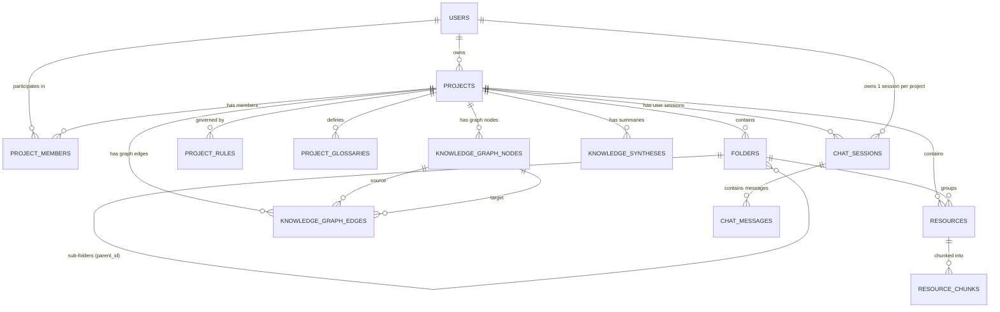

# PostgreSQL Database Schema & Data Models 🗄️

เอกสารฉบับนี้กำหนดโครงสร้างฐานข้อมูลเชิงสัมพันธ์และเวกเตอร์ (Relational & Vector Data Schema) สำหรับ **PostgreSQL 16** พร้อมส่วนขยาย `pgvector` เพื่อรองรับ Multi-user, 2-Pillar Project Workspace, Living Knowledge Hub, Rules Engine และ 1-User-1-Session AI Chat

---

## 1. ผังความสัมพันธ์ของข้อมูล (Entity-Relationship Diagram: ERD)



---

## 2. นิยามโครงสร้างตาราง (DDL & Table Specifications)

### 2.1 ส่วนขยายที่จำเป็น (Extensions)
```sql
CREATE EXTENSION IF NOT EXISTS "uuid-ossp";
CREATE EXTENSION IF NOT EXISTS "vector";      -- สำหรับ pgvector (RAG Embeddings)
CREATE EXTENSION IF NOT EXISTS "pg_trgm";     -- สำหรับค้นหาคำศัพท์ใน Glossary
```

---

### 2.2 ตารางผู้ใช้และการจัดการสิทธิ์ (Auth & Workspaces)

#### `users` (ข้อมูลผู้ใช้)
```sql
CREATE TABLE users (
    id UUID PRIMARY KEY DEFAULT uuid_generate_v4(),
    email VARCHAR(255) UNIQUE NOT NULL,
    hashed_password VARCHAR(255) NOT NULL,
    full_name VARCHAR(150),
    avatar_url TEXT,
    created_at TIMESTAMP WITH TIME ZONE DEFAULT CURRENT_TIMESTAMP,
    updated_at TIMESTAMP WITH TIME ZONE DEFAULT CURRENT_TIMESTAMP
);
```

#### `projects` (พื้นที่ทำงานโปรเจกต์)
```sql
CREATE TABLE projects (
    id UUID PRIMARY KEY DEFAULT uuid_generate_v4(),
    name VARCHAR(200) NOT NULL,
    description TEXT,
    owner_id UUID NOT NULL REFERENCES users(id) ON DELETE CASCADE,
    domain_metadata JSONB DEFAULT '{}'::jsonb, -- ข้อมูลบริบทเสริม เช่น อุตสาหกรรม, ภาษาหลัก
    created_at TIMESTAMP WITH TIME ZONE DEFAULT CURRENT_TIMESTAMP,
    updated_at TIMESTAMP WITH TIME ZONE DEFAULT CURRENT_TIMESTAMP
);

CREATE INDEX idx_projects_owner ON projects(owner_id);
```

#### `project_members` (สมาชิกในโปรเจกต์)
```sql
CREATE TABLE project_members (
    id UUID PRIMARY KEY DEFAULT uuid_generate_v4(),
    project_id UUID NOT NULL REFERENCES projects(id) ON DELETE CASCADE,
    user_id UUID NOT NULL REFERENCES users(id) ON DELETE CASCADE,
    role VARCHAR(50) NOT NULL CHECK (role IN ('owner', 'editor', 'viewer')),
    joined_at TIMESTAMP WITH TIME ZONE DEFAULT CURRENT_TIMESTAMP,
    UNIQUE (project_id, user_id)
);
```

---

### 2.3 เสาหลักที่ 1: คลังทรัพยากร (Resource Pillar)

#### `folders` (โครงสร้างโฟลเดอร์แบบลำดับขั้น)
```sql
CREATE TABLE folders (
    id UUID PRIMARY KEY DEFAULT uuid_generate_v4(),
    project_id UUID NOT NULL REFERENCES projects(id) ON DELETE CASCADE,
    parent_id UUID REFERENCES folders(id) ON DELETE CASCADE, -- NULL แปลว่าเป็น Root Folder
    name VARCHAR(150) NOT NULL,
    sort_order INT DEFAULT 0,
    created_at TIMESTAMP WITH TIME ZONE DEFAULT CURRENT_TIMESTAMP,
    updated_at TIMESTAMP WITH TIME ZONE DEFAULT CURRENT_TIMESTAMP
);

CREATE INDEX idx_folders_project_parent ON folders(project_id, parent_id);
```

#### `resources` (เอกสารต้นฉบับและผลลัพธ์ HTML)
```sql
CREATE TABLE resources (
    id UUID PRIMARY KEY DEFAULT uuid_generate_v4(),
    project_id UUID NOT NULL REFERENCES projects(id) ON DELETE CASCADE,
    folder_id UUID REFERENCES folders(id) ON DELETE SET NULL,
    name VARCHAR(255) NOT NULL,
    file_type VARCHAR(20) NOT NULL CHECK (file_type IN ('docx', 'pdf', 'txt', 'md', 'url', 'ai_generated')),
    original_url TEXT,
    file_size_bytes BIGINT DEFAULT 0,
    raw_text TEXT NOT NULL,                  -- ข้อความธรรมดาคงเนื้อหาครบ 100%
    semantic_html TEXT NOT NULL,             -- HTML พร้อม Anchor ID สำหรับ Reader GUI
    status VARCHAR(50) NOT NULL DEFAULT 'pending' 
        CHECK (status IN ('pending', 'processing', 'ready', 'failed')),
    error_message TEXT,
    created_by UUID REFERENCES users(id) ON DELETE SET NULL,
    created_at TIMESTAMP WITH TIME ZONE DEFAULT CURRENT_TIMESTAMP,
    updated_at TIMESTAMP WITH TIME ZONE DEFAULT CURRENT_TIMESTAMP
);

CREATE INDEX idx_resources_project_folder ON resources(project_id, folder_id);
CREATE INDEX idx_resources_status ON resources(status);
```

#### `resource_chunks` (ชิ้นส่วนข้อความและเวกเตอร์สำหรับ RAG)
```sql
CREATE TABLE resource_chunks (
    id UUID PRIMARY KEY DEFAULT uuid_generate_v4(),
    resource_id UUID NOT NULL REFERENCES resources(id) ON DELETE CASCADE,
    project_id UUID NOT NULL REFERENCES projects(id) ON DELETE CASCADE,
    chunk_index INT NOT NULL,
    anchor_id VARCHAR(50) NOT NULL,          -- เช่น "p-012", "tbl-003" ตรงกับ semantic_html
    content TEXT NOT NULL,
    embedding vector(1536),                  -- มิติเวกเตอร์ 1536 (OpenAI / standard)
    tsv tsvector GENERATED ALWAYS AS (to_tsvector('simple', content)) STORED,
    created_at TIMESTAMP WITH TIME ZONE DEFAULT CURRENT_TIMESTAMP
);

-- HNSW Vector Index เพื่อการค้นหาเวกเตอร์ระดับมิลลิวินาที
CREATE INDEX idx_chunks_embedding ON resource_chunks 
USING hnsw (embedding vector_cosine_ops) WITH (m = 16, ef_construction = 64);

-- Full-text GIN Index
CREATE INDEX idx_chunks_tsv ON resource_chunks USING gin(tsv);
CREATE INDEX idx_chunks_project ON resource_chunks(project_id);
```

---

### 2.4 เสาหลักที่ 2: ศูนย์รวมองค์ความรู้ (Knowledge Pillar)

#### `project_glossaries` (พจนานุกรมศัพท์เฉพาะทาง Living Glossary)
```sql
CREATE TABLE project_glossaries (
    id UUID PRIMARY KEY DEFAULT uuid_generate_v4(),
    project_id UUID NOT NULL REFERENCES projects(id) ON DELETE CASCADE,
    term VARCHAR(150) NOT NULL,
    aliases TEXT[] DEFAULT '{}',             -- คำย่อ หรือชื่อเรียกอื่น
    definition TEXT NOT NULL,                -- คำอธิบายความหมายที่ AI หรือ User สร้าง
    source_resource_ids UUID[] DEFAULT '{}', -- เอกสารที่พบคำนี้
    is_ai_generated BOOLEAN DEFAULT TRUE,
    is_verified BOOLEAN DEFAULT FALSE,       -- ผู้ใช้กดยืนยันตรวจทานแล้วหรือไม่
    created_at TIMESTAMP WITH TIME ZONE DEFAULT CURRENT_TIMESTAMP,
    updated_at TIMESTAMP WITH TIME ZONE DEFAULT CURRENT_TIMESTAMP,
    UNIQUE (project_id, term)
);

CREATE INDEX idx_glossary_project_term ON project_glossaries(project_id, term);
```

#### `knowledge_graph_nodes` (โหนดใน Knowledge Graph)
```sql
CREATE TABLE knowledge_graph_nodes (
    id UUID PRIMARY KEY DEFAULT uuid_generate_v4(),
    project_id UUID NOT NULL REFERENCES projects(id) ON DELETE CASCADE,
    node_key VARCHAR(150) NOT NULL,          -- Identifier ภายในโปรเจกต์ เช่น "fastapi"
    label VARCHAR(200) NOT NULL,             -- ข้อความที่แสดงบน Node
    node_type VARCHAR(50) NOT NULL CHECK (node_type IN ('CONCEPT', 'ENTITY', 'TOPIC', 'SOURCE_DOC')),
    summary TEXT,
    metadata_json JSONB DEFAULT '{}'::jsonb,
    created_at TIMESTAMP WITH TIME ZONE DEFAULT CURRENT_TIMESTAMP,
    updated_at TIMESTAMP WITH TIME ZONE DEFAULT CURRENT_TIMESTAMP,
    UNIQUE (project_id, node_key)
);

CREATE INDEX idx_graph_nodes_project ON knowledge_graph_nodes(project_id);
```

#### `knowledge_graph_edges` (เส้นเชื่อมความสัมพันธ์ใน Knowledge Graph)
```sql
CREATE TABLE knowledge_graph_edges (
    id UUID PRIMARY KEY DEFAULT uuid_generate_v4(),
    project_id UUID NOT NULL REFERENCES projects(id) ON DELETE CASCADE,
    source_node_id UUID NOT NULL REFERENCES knowledge_graph_nodes(id) ON DELETE CASCADE,
    target_node_id UUID NOT NULL REFERENCES knowledge_graph_nodes(id) ON DELETE CASCADE,
    relation_type VARCHAR(50) NOT NULL,      -- เช่น 'defines', 'depends_on', 'relates_to', 'part_of'
    description TEXT,
    weight FLOAT DEFAULT 1.0,
    created_at TIMESTAMP WITH TIME ZONE DEFAULT CURRENT_TIMESTAMP,
    UNIQUE (project_id, source_node_id, target_node_id, relation_type)
);

CREATE INDEX idx_graph_edges_project ON knowledge_graph_edges(project_id);
```

#### `knowledge_syntheses` (บทสรุปองค์ความรู้ที่ AI ตกผลึก)
```sql
CREATE TABLE knowledge_syntheses (
    id UUID PRIMARY KEY DEFAULT uuid_generate_v4(),
    project_id UUID NOT NULL REFERENCES projects(id) ON DELETE CASCADE,
    title VARCHAR(255) NOT NULL,
    synthesis_type VARCHAR(50) NOT NULL CHECK (synthesis_type IN ('executive_brief', 'topic_summary', 'takeaway', 'generated_doc')),
    content_html TEXT NOT NULL,
    source_resource_ids UUID[] DEFAULT '{}',
    created_at TIMESTAMP WITH TIME ZONE DEFAULT CURRENT_TIMESTAMP,
    updated_at TIMESTAMP WITH TIME ZONE DEFAULT CURRENT_TIMESTAMP
);
```

---

### 2.5 ระบบควบคุมพฤติกรรม AI: Project Rules

#### `project_rules` (กฎและข้อจำกัดของ AI ประจำโปรเจกต์)
```sql
CREATE TABLE project_rules (
    id UUID PRIMARY KEY DEFAULT uuid_generate_v4(),
    project_id UUID NOT NULL REFERENCES projects(id) ON DELETE CASCADE,
    name VARCHAR(150) NOT NULL,
    description TEXT,
    rule_type VARCHAR(50) NOT NULL CHECK (rule_type IN ('do', 'dont', 'persona', 'format')),
    instruction TEXT NOT NULL,               -- ข้อความคำสั่งที่ส่งเข้า System Prompt
    is_active BOOLEAN DEFAULT TRUE,
    created_by UUID REFERENCES users(id) ON DELETE SET NULL,
    created_at TIMESTAMP WITH TIME ZONE DEFAULT CURRENT_TIMESTAMP,
    updated_at TIMESTAMP WITH TIME ZONE DEFAULT CURRENT_TIMESTAMP
);

CREATE INDEX idx_rules_project_active ON project_rules(project_id, is_active);
```

---

### 2.6 ระบบสนทนา: 1-User-1-Session AI System

#### `chat_sessions` (Session ประจำตัวผู้ใช้: 1 Session ต่อคนต่อโปรเจกต์)
```sql
CREATE TABLE chat_sessions (
    id UUID PRIMARY KEY DEFAULT uuid_generate_v4(),
    project_id UUID NOT NULL REFERENCES projects(id) ON DELETE CASCADE,
    user_id UUID NOT NULL REFERENCES users(id) ON DELETE CASCADE,
    title VARCHAR(200) DEFAULT 'My AI Workspace Session',
    context_scope_json JSONB DEFAULT '{"scope": "all"}'::jsonb, -- ฟิลเตอร์โฟลเดอร์/ไฟล์ที่เลือกคุย
    created_at TIMESTAMP WITH TIME ZONE DEFAULT CURRENT_TIMESTAMP,
    updated_at TIMESTAMP WITH TIME ZONE DEFAULT CURRENT_TIMESTAMP,
    UNIQUE (project_id, user_id)             -- รับประกันกฎเหล็ก: 1 User มี 1 Session ต่อโปรเจกต์เท่านั้น
);
```

#### `chat_messages` (ข้อความการสนทนาและประวัติการโต้ตอบ)
```sql
CREATE TABLE chat_messages (
    id UUID PRIMARY KEY DEFAULT uuid_generate_v4(),
    session_id UUID NOT NULL REFERENCES chat_sessions(id) ON DELETE CASCADE,
    role VARCHAR(20) NOT NULL CHECK (role IN ('user', 'assistant', 'system')),
    content TEXT NOT NULL,
    citations_json JSONB DEFAULT '[]'::jsonb, -- รายการอ้างอิง [{resource_id, anchor_id, quote}]
    created_at TIMESTAMP WITH TIME ZONE DEFAULT CURRENT_TIMESTAMP
);

CREATE INDEX idx_messages_session_time ON chat_messages(session_id, created_at ASC);
```
