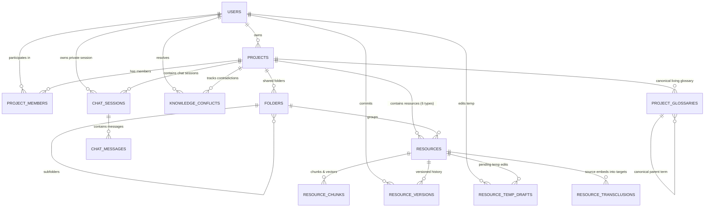

# Data Schema Specification

**Document Version**: 1.0.0
**Status**: Active

This document specifies the PostgreSQL 16 relational tables and `pgvector` schemas supporting multi-format resources, single-source-of-truth transclusions, shared temp drafts, living glossaries, and conflict tracking.

---

## 1. Entity-Relationship Diagram (ERD)



---

## 2. DDL Table Specifications

### 2.1 `resource_transclusions` (Single Source of Truth Tracking)
```sql
CREATE TABLE resource_transclusions (
    id UUID PRIMARY KEY DEFAULT gen_random_uuid(),
    project_id UUID NOT NULL REFERENCES projects(id) ON DELETE CASCADE,
    source_resource_id UUID NOT NULL REFERENCES resources(id) ON DELETE CASCADE,
    source_anchor_id VARCHAR(100) NOT NULL,
    target_resource_id UUID NOT NULL REFERENCES resources(id) ON DELETE CASCADE,
    target_anchor_id VARCHAR(100) NOT NULL,
    sync_mode VARCHAR(20) DEFAULT 'auto',
    created_at TIMESTAMPTZ DEFAULT NOW(),
    CONSTRAINT uq_transclusion UNIQUE(source_resource_id, source_anchor_id, target_resource_id, target_anchor_id)
);

CREATE INDEX idx_transclusion_source ON resource_transclusions(source_resource_id, source_anchor_id);
CREATE INDEX idx_transclusion_target ON resource_transclusions(target_resource_id);
```

### 2.2 `resource_temp_drafts` (Shared Temp Draft Store)
```sql
CREATE TABLE resource_temp_drafts (
    id UUID PRIMARY KEY DEFAULT gen_random_uuid(),
    resource_id UUID NOT NULL REFERENCES resources(id) ON DELETE CASCADE,
    anchor_id VARCHAR(100) NOT NULL,
    temp_html TEXT NOT NULL,
    edited_by UUID NOT NULL REFERENCES users(id),
    updated_at TIMESTAMPTZ DEFAULT NOW(),
    CONSTRAINT uq_resource_anchor UNIQUE(resource_id, anchor_id)
);

CREATE INDEX idx_temp_drafts_resource ON resource_temp_drafts(resource_id);
```

### 2.3 `project_glossaries` (Canonical Living Glossary)
```sql
CREATE TABLE project_glossaries (
    id UUID PRIMARY KEY DEFAULT gen_random_uuid(),
    project_id UUID NOT NULL REFERENCES projects(id) ON DELETE CASCADE,
    term VARCHAR(150) NOT NULL,
    is_canonical BOOLEAN DEFAULT TRUE,
    canonical_id UUID REFERENCES project_glossaries(id) ON DELETE SET NULL,
    meaning TEXT NOT NULL,
    category VARCHAR(50) DEFAULT 'general',
    frequency_count INT DEFAULT 1,
    created_at TIMESTAMPTZ DEFAULT NOW(),
    updated_at TIMESTAMPTZ DEFAULT NOW(),
    CONSTRAINT uq_project_term UNIQUE(project_id, term)
);

CREATE INDEX idx_glossary_project_term ON project_glossaries(project_id, term);
CREATE INDEX idx_glossary_canonical ON project_glossaries(canonical_id);
```

### 2.4 `knowledge_conflicts` (Conflict Detection Audit Table)
```sql
CREATE TABLE knowledge_conflicts (
    id UUID PRIMARY KEY DEFAULT gen_random_uuid(),
    project_id UUID NOT NULL REFERENCES projects(id) ON DELETE CASCADE,
    source_resource_id UUID NOT NULL REFERENCES resources(id) ON DELETE CASCADE,
    source_anchor_id VARCHAR(100),
    conflicting_resource_id UUID NOT NULL REFERENCES resources(id) ON DELETE CASCADE,
    conflicting_anchor_id VARCHAR(100),
    claim_a TEXT NOT NULL,
    claim_b TEXT NOT NULL,
    severity VARCHAR(20) DEFAULT 'warning',
    status VARCHAR(20) DEFAULT 'detected',
    resolved_by UUID REFERENCES users(id),
    detected_at TIMESTAMPTZ DEFAULT NOW(),
    resolved_at TIMESTAMPTZ
);

CREATE INDEX idx_conflicts_project ON knowledge_conflicts(project_id, status);
```

### 2.5 `resources` & `resource_chunks` (pgvector Vector Index)
```sql
CREATE TABLE resources (
    id UUID PRIMARY KEY DEFAULT gen_random_uuid(),
    project_id UUID NOT NULL REFERENCES projects(id) ON DELETE CASCADE,
    folder_id UUID REFERENCES folders(id) ON DELETE SET NULL,
    name VARCHAR(255) NOT NULL,
    resource_type VARCHAR(50) NOT NULL,
    current_version INT DEFAULT 1,
    content_html TEXT NOT NULL,
    created_at TIMESTAMPTZ DEFAULT NOW(),
    updated_at TIMESTAMPTZ DEFAULT NOW()
);

CREATE TABLE resource_chunks (
    id UUID PRIMARY KEY DEFAULT gen_random_uuid(),
    resource_id UUID NOT NULL REFERENCES resources(id) ON DELETE CASCADE,
    anchor_id VARCHAR(100) NOT NULL,
    chunk_text TEXT NOT NULL,
    embedding vector(1536),
    created_at TIMESTAMPTZ DEFAULT NOW()
);

CREATE INDEX idx_chunks_embedding ON resource_chunks USING hnsw (embedding vector_cosine_ops);
```
