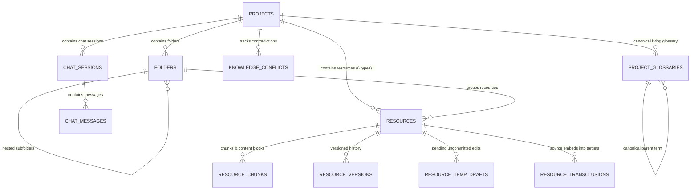

# Data Schema Specification

**Document Version**: 2.0.0
**Status**: Active

This document specifies the local-first data models, TypeScript interfaces, and browser storage representations supporting multi-format resources, transclusions, shared temp drafts, living glossaries, and conflict tracking.

---

## 1. Entity-Relationship Diagram (ERD)



---

## 2. Local-First Storage Specifications

### 2.1 `Folder` & `Resource` Model
```typescript
export interface Folder {
  id: string
  name: string
  count: number
  open: boolean
  children: string[]
  folders?: Folder[]
}

export interface Resource {
  name: string
  type: 'Document' | 'Table' | 'Presentation' | 'Graph' | 'Image' | 'Code' | string
  icon?: any
  color?: string
  detail: string
  content?: string
}
```

### 2.2 `ResourceTempDraft` (Shared Temp Draft Store)
```typescript
export interface ResourceTempDraft {
  resourceName: string
  anchorId: string
  tempHtml: string
  updatedAt: number
}
```

### 2.3 `ResourceTransclusion` (Single Source of Truth Tracking)
```typescript
export interface ResourceTransclusion {
  id: string
  sourceResourceName: string
  sourceAnchorId: string
  targetResourceName: string
  targetAnchorId: string
  syncMode: 'auto' | 'manual'
  createdAt: number
}
```

### 2.4 `CanonicalTerm` (Living Glossary)
```typescript
export interface CanonicalTerm {
  canonical: string
  aliases: string[]
  mentions: number
  category: 'Architecture' | 'State & Sync' | 'AI & Trust' | 'Data'
  definition: string
  linkedResources: string[]
}
```

### 2.5 `KnowledgeConflict` (Conflict Detection Audit Model)
```typescript
export interface KnowledgeConflict {
  id: string
  sourceResource: string
  sourceAnchorId?: string
  conflictingResource: string
  conflictingAnchorId?: string
  claimA: string
  claimB: string
  severity: 'critical' | 'warning'
  status: 'detected' | 'resolved'
  detectedAt: number
}
```
