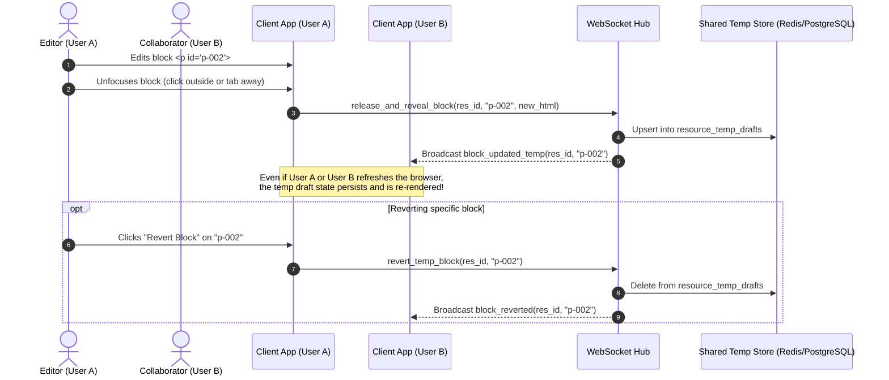
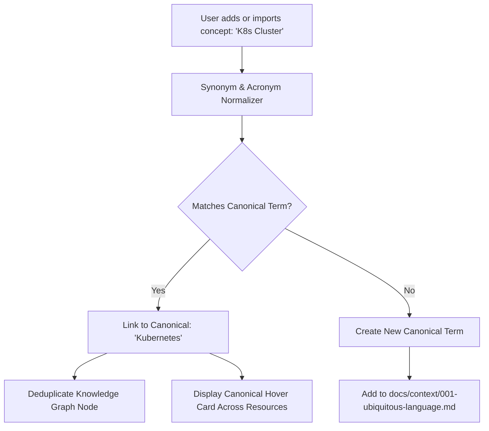
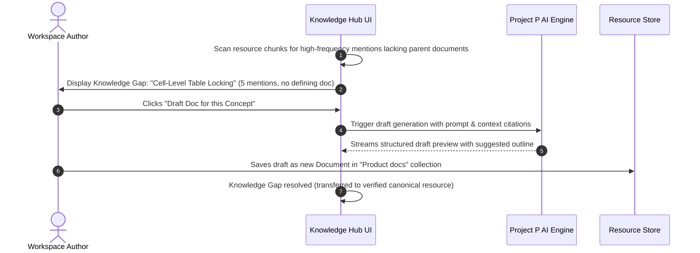

# User Journeys and Workflows

**Document Version**: 1.0.0
**Status**: Active

This document specifies the primary user journeys, sequence interactions, and workflow state machines for Project P.

---

## 1. Shared Temp Draft Collaboration Workflow



---

## 2. 3-Tab Save Modal with Selective Staging Workflow

```mermaid
sequenceDiagram
    autonumber
    actor User as Workspace Author
    participant UI as 3-Tab Save Modal
    participant API as FastAPI Gateway
    participant Worker as Background Sync Worker
    participant DB as PostgreSQL Core DB

    User->>UI: Clicks "Save Resource"
    UI->>API: GET /api/v1/projects/{id}/resources/{res_id}/save-modal-data
    API-->>UI: Returns 3 tabs: Original, Temp Diff (+words/-words), Conflict Detection Report
    
    UI->>User: Renders 3-Tab Save Modal
    Note over UI,User: Tab 1: Full original text<br/>Tab 2: Diff view with per-block checkboxes<br/>Tab 3: Commit notes and cross-source conflict report
    
    User->>UI: Selects [✓] Blocks 1 & 2 (leaves Block 3 unchecked)
    User->>UI: Enters commit message: "Update phase 1 dosage metrics" and clicks Commit
    
    UI->>API: PUT /api/v1/.../save-selective (selected_anchor_ids: ["p-1", "p-2"])
    API->>DB: Commit selected blocks to resource_versions; delete selected from resource_temp_drafts
    Note over DB: Block 3 remains in resource_temp_drafts as pending temp edit
    
    API->>Worker: Enqueue Incremental Delta Sync (only for committed blocks)
    Worker->>DB: Update pgvector chunks & living knowledge nodes
    API-->>UI: Commit success response
```

---

## 3. Canonical Term Standardization Flow



---

## 4. Knowledge Gap Discovery & AI Drafting Flow


