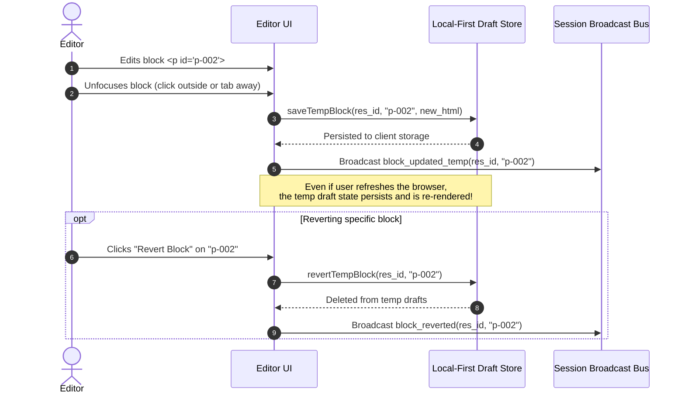
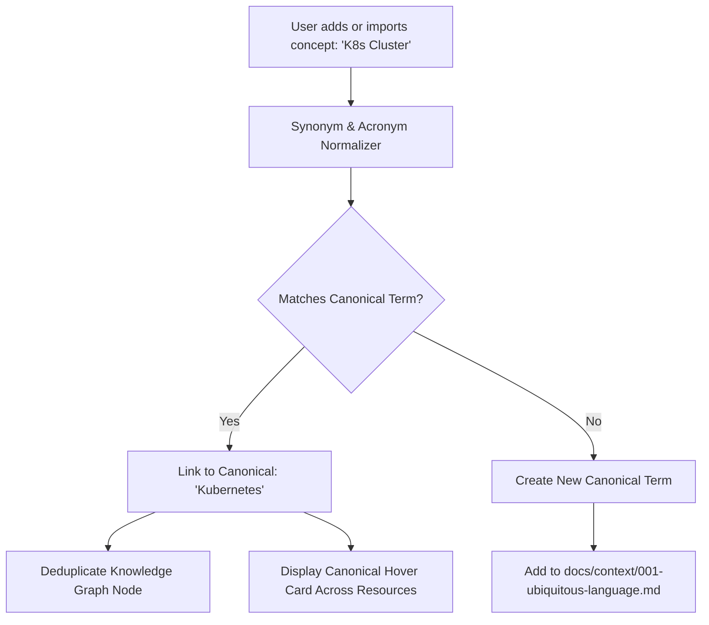
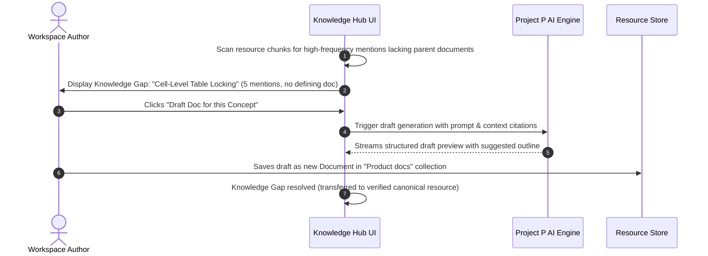

# User Journeys and Workflows

**Document Version**: 1.0.0
**Status**: Active

This document specifies the primary user journeys, sequence interactions, and workflow state machines for Project P.

---

## 1. Shared Temp Draft Collaboration Workflow



---

## 2. 3-Tab Save Modal with Selective Staging Workflow

```mermaid
sequenceDiagram
    autonumber
    actor User as Workspace Author
    participant UI as 3-Tab Save Modal
    participant Store as Local-First Resource Store
    participant Engine as Conflict & Index Engine

    User->>UI: Clicks "Save Resource"
    UI->>Store: getSaveModalData(res_id)
    Store->>Engine: Run contradiction check against workspace resources
    Engine-->>Store: Detected conflicts report
    Store-->>UI: Returns 3 tabs: Original, Temp Diff (+words/-words), Conflict Report
    
    UI->>User: Renders 3-Tab Save Modal
    Note over UI,User: Tab 1: Full original text<br/>Tab 2: Diff view with per-block checkboxes<br/>Tab 3: Commit notes and cross-source conflict report
    
    User->>UI: Selects [✓] Blocks 1 & 2 (leaves Block 3 unchecked)
    User->>UI: Enters commit message: "Update phase 1 dosage metrics" and clicks Commit
    
    UI->>Store: commitSelective(selected_anchor_ids: ["p-1", "p-2"])
    Store->>Store: Commit selected blocks to resource; delete selected from temp drafts
    Note over Store: Block 3 remains in temp drafts as pending edit
    
    Store->>Engine: Sync knowledge index (only for committed blocks)
    UI-->>User: Commit success confirmation
```

---

## 3. Canonical Term Standardization Flow



---

## 4. Knowledge Gap Discovery & AI Drafting Flow


