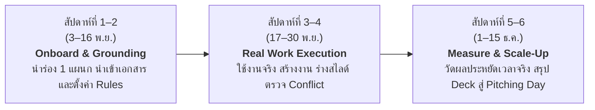

# Project P: เปลี่ยนข้อมูลของโปรเจกต์ ให้กลายเป็นงานที่ทำต่อได้ทันที

**ต้นฉบับเนื้อหาสำหรับนำเสนอ Project P**
**เวอร์ชัน:** 2.0 (อัปเกรดฟีเจอร์ Enterprise Governance, Rules Engine & Interactive Viewers)
**อัปเดตล่าสุด:** 27 ตุลาคม 2026
**รูปแบบ:** วิดีโอนำเสนอไม่เกิน 4 นาที | ธีม Simplify to Amplify (Process Optimization)

> ไฟล์นี้เป็นต้นฉบับสำหรับสไลด์และวิดีโอของ Project P หากจะปรับข้อความ ตัวอย่าง ตัวเลข หรือความสามารถของแอป ให้แก้ที่นี่ก่อนเสมอ

---

## แก่นของเรื่อง (Core Narrative)

ในหนึ่งโปรเจกต์ เรามีทั้งเอกสาร ตาราง สไลด์ แผนภาพสถาปัตยกรรม รูปภาพ และแชตคุยงานกระจัดกระจายอยู่ทุกหนแห่ง แต่เมื่อต้องทำงานจริง เรากลับเสียเวลาหลายชั่วโมงไปกับการตามหาไฟล์ เช็กเวอร์ชันล่าสุด และตรวจเช็กว่า AI ที่แต่ละคนใช้ตอบข้อมูลตรงกันหรือไม่

**Project P** รวมข้อมูลมัลติฟอร์แมตทั้งหมดเข้าเป็น **Single Source of Truth (ข้อมูลกลางของโปรเจกต์)** ที่เชื่อมโยงถึงกัน พร้อมระบบ **Workspace Rules & Safety Guardrails** ที่คอยกำกับให้ AI ตอบอย่างมีวินัย ตรวจจับข้อมูลขัดแย้งอัตโนมัติ และแยกพื้นที่ส่วนตัว (Private) ออกจากข้อมูลส่วนกลางอย่างปลอดภัย

**ประโยคที่อยากให้คนดูจำได้**
*Project P ไม่ได้เพิ่มข้อมูลให้ทีม แต่ทำให้ข้อมูลที่มีอยู่ ถูกหยิบมาสร้างงานและต่อยอดได้อย่างแม่นยำ ปลอดภัย และไร้รอยต่อ*

---

## สไลด์ 1 — เปิดเรื่อง (Hook): ข้อมูลมีครบ แต่งานยังไปต่อไม่ได้

**เวลาพูด:** 0:00–0:15

### ข้อความบนสไลด์

## ข้อมูลของโปรเจกต์มีอยู่ครบ
## แต่ตอนต้องใช้ กลับหาไม่เจอ และไม่รู้ว่าเชื่อใครได้

เอกสาร ตาราง สไลด์ แผนภาพ และแชตคุยงาน
อยู่คนละที่ คนละเวอร์ชัน และ AI ของแต่ละคนก็ตอบไปคนละทาง

### สิ่งที่พูด

“เวลาจะทำสไลด์ รายงาน หรือแผนงาน เราไม่ได้เริ่มจากไอเดีย แต่เริ่มจากการตามหาไฟล์ ถามหาเวอร์ชันล่าสุด และพอใช้ AI ช่วยสรุป ก็ยังไม่แน่ใจว่า AI กำลังให้ข้อมูลจริงหรือกำลังเดา… กว่างานจะเริ่ม เวลาก็หายไปแล้วครับ”

### ภาพที่แนะนำ

ภาพไฟล์ ตาราง ไดอะแกรม และหน้าต่างแชตลอยกระจัดกระจาย ก่อนจะค่อย ๆ ถูกจัดระเบียบและดึงดูดเข้าสู่ศูนย์กลางเดียว

---

## สไลด์ 2 — ปัญหา (Pain Point & Baseline): เวลาที่เสียไปกับการหาและตรวจเช็ก คือต้นทุนมหาศาล

**เวลาพูด:** 0:15–1:00

### ข้อความบนสไลด์

## ปัญหาไม่ใช่การขาดข้อมูล
## แต่คือกระบวนการทำงานที่ซ้ำซ้อนและไร้การควบคุม

- **เสียเวลาตามหาและตรวจเวอร์ชัน:** ทีมเสียเวลาเฉลี่ย 3–5 ชม./สัปดาห์ ในการรวบรวมข้อมูลก่อนเริ่มลงมือทำ
- **ข้อมูลขัดแย้งกันเอง (Data Drift):** แก้ตัวเลขในเอกสาร A แต่ลืมแก้ในสไลด์ B ทำให้ข้อมูลที่ถึงผู้บริหารไม่ตรงกัน
- **AI ไร้การควบคุม (Uncontrolled AI):** ทุกคนใช้ AI ส่วนตัว แต่ AI ไม่รู้บริบทจริง ตอบมั่ว (Hallucination) หรือเสี่ยงนำข้อมูลความลับออกไปภายนอก
- **ความกังวลเรื่องความเป็นส่วนตัว:** คนทำงานไม่กล้าบันทึกโน้ตหรือไอเดียดราฟต์ เพราะกลัวระบบดูดไปแชร์ให้คนอื่น
- **ภาษาและคำเรียกไม่ตรงกัน:** เรื่องเดียวกันถูกเรียกคนละชื่อ ทำให้การค้นหาและประสานงานคลาดเคลื่อน

### สิ่งที่พูด

“ปัจจุบันพวกเราเสียเวลาทำงานซ้ำซ้อนไปกับการ 'ค้นหา ถามซ้ำ และตรวจเช็ก' สูงถึงกว่า 20% ของเวลาทำงานทั้งหมด และที่น่ากลัวกว่านั้นคือ เมื่อต่างคนต่างใช้ AI สรุปงาน ข้อมูลที่ได้กลับไม่ตรงกัน เพราะไม่มีกฎเกณฑ์หรือแหล่งข้อมูลกลางคอยกำกับ ส่งผลให้เกิดความเข้าใจผิดและการทำงานแก้ซ้ำหลายรอบครับ”

### ภาพที่แนะนำ

เส้นทางงานที่ยุ่งเหยิงและสูญเปล่า: **ค้นหาไฟล์หลายแหล่ง → ถามเพื่อนร่วมทีม → ตรวจสอบเวอร์ชัน → AI ตอบไม่ตรงกัน → เกิดข้อขัดแย้งในที่ประชุม**

---

## สไลด์ 3 — ต้นเหตุ (Root Cause): ข้อมูลแยกชิ้น ไร้ความเชื่อมโยง และขาด Safety Guardrails

**เวลาพูด:** 1:00–1:20

### ข้อความบนสไลด์

## ไฟล์มีครบ
## แต่ขาดศูนย์กลางความรู้และระบบกำกับความถูกต้อง

1. **ข้อมูลยังแยกเป็นไซโล (Data Silos):** เอกสาร ตาราง โค้ด และไดอะแกรมอยู่คนละเครื่องมือ ไม่เชื่อมโยงกัน
2. **ไม่มีระบบตรวจจับข้อขัดแย้ง (No Conflict Guard):** การเปลี่ยนแปลงจุดหนึ่ง ไม่ส่งผลกระทบสะท้อนไปยังงานอื่นที่เกี่ยวข้อง
3. **ขาด Workspace Rules สำหรับ AI:** AI ทั่วไปไม่มีขอบเขตด้านความปลอดภัย (Do/Avoid) ทำให้ผลลัพธ์ขาดมาตรฐานองค์กร

### สิ่งที่พูด

“รากเหง้าของปัญหาไม่ใช่ว่าเราไม่มีระบบเก็บไฟล์ แต่คือระบบเดิม ‘ไม่รู้ความสัมพันธ์ของข้อมูล’ และ ‘ไม่มีระบบควบคุม AI ในระดับโปรเจกต์’ ทำให้เมื่อข้อมูลจุดหนึ่งเปลี่ยน งานส่วนอื่นก็กลายเป็นข้อมูลเก่าโดยที่เราไม่รู้ตัว”

### ภาพที่แนะนำ

แผนภาพเปรียบเทียบ:
- **ก่อนใช้:** ข้อมูลแตกกระจายเป็นเกาะโดดเดี่ยว ไร้การควบคุม
- **หลังใช้:** ข้อมูลกลางเชื่อมโยงกันเป็นเครือข่ายความรู้ พร้อมมี Safety Guardrails โอบล้อม

---

## สไลด์ 4 — ทางออก (Solution): Project P — ศูนย์กลางความรู้และกระบวนการทำงานที่ปลอดภัย

**เวลาพูด:** 1:20–2:20

### ข้อความบนสไลด์

## Project P
## Simplify to Amplify: ทำให้ง่าย เพื่อผลลัพธ์ที่ก้าวกระโดด

### 1. Unified SSoT & Multi-Format Viewers
รวบรวมเอกสาร, สไลด์, ตารางข้อมูล, โค้ด และ **Interactive Graph Diagrams (Mermaid)** ไว้ที่เดียว จัดการง่ายด้วย File Explorer แบบคลิกขวาและลากวาง (Drag & Drop)

### 2. Guarded AI Assistant & Workspace Rules
สั่งงานผ่าน Centered Chat Bar ด้านล่าง โดยมี **Rules Engine (`/rules`)** คุมเข้ม ทั้งคำสั่งที่ต้องทำ (`Do`) และข้อห้ามเด็ดขาด (`Avoid`) พร้อมแสดง **Audit Badge** ยืนยันกฎที่บังคับใช้ทุกครั้ง

### 3. Private Section — แยกพื้นที่ส่วนตัวอย่างเด็ดขาด
มีโซน **Private** สำหรับจดโน้ตและดราฟต์งานส่วนตัว โดยระบบตัดการเชื่อมต่อจากสมองกลาง (Knowledge Index) 100% จึงมั่นใจว่าไอเดียดิบจะไม่รั่วไหล

### 4. Dual-Stage Conflict Detection & 3-Tab Save
ระบบตรวจจับข้อขัดแย้งอัตโนมัติ 2 ชั้น (ตอนสร้าง และตอนบันทึก) พร้อม **3-Tab Save Modal** แสดงผลต่าง (Diff), แผนผังผลกระทบ (Dependency Graph), และจุดขัดแย้ง ก่อนยืนยันเข้าข้อมูลกลาง

### ตัวอย่างการสั่งงานในคลิป (Demo Scenario)

> *“ช่วยร่างสไลด์สรุป Roadmap และ Architecture ของโปรเจกต์สำหรับผู้บริหาร โดยอิงตามนโยบายความปลอดภัยล่าสุด”*

Project P จะดึงข้อมูลพร้อมแสดงแหล่งอ้างอิง ตรวจสอบกับ Workspace Rules แล้วร่างสไลด์และไดอะแกรมที่แก้ไขต่อได้ทันที

### สิ่งที่พูด

“Project P แก้ปัญหานี้ด้วยคอนเซปต์ Simplify to Amplify: เราผสานข้อมูลมัลติฟอร์แมต ทั้งเอกสาร ตาราง สไลด์ และไดอะแกรม Mermaid เข้ากับระบบ Workspace Rules ทำให้เราสั่งงานผ่าน Chat Bar ได้ทันที โดยมั่นใจได้ว่า AI จะตอบภายใต้กฎความปลอดภัย มีที่มาอ้างอิงชัดเจน และก่อนจะบันทึกงานใหม่เข้าสู่ระบบกลาง ระบบจะช่วยตรวจเช็กผลกระทบและข้อขัดแย้งด้วย 3-Tab Save Modal ทันทีครับ”

### ภาพที่แนะนำ (ช่วงเดโมสั้น 30–40 วินาที)

1. **Centered Chat Bar** พร้อมแบดจ์ `ShieldCheck: 4 rules`
2. **Interactive Graph Viewer** กำลังแสดงไดอะแกรม Flowchart / Sequence ที่ซูมเข้าออกได้
3. **3-Tab Save Modal** แสดง Diff และการตรวจจับ Conflict ก่อนบันทึก
4. **Private Section** ใน Sidebar ที่มีแม่กุญแจล็อกเพื่อความปลอดภัย

---

## สไลด์ 5 — ผลลัพธ์ (Expected Impact): ตัดเวลาตามหา เพิ่มเวลาสร้างสรรค์ พร้อมมาตรฐานองค์กร

**เวลาพูด:** 2:20–2:55

### ข้อความบนสไลด์

## ผลลัพธ์ที่คาดว่าจะได้ (Measurable Impact)
## วัดผลได้จริงในเชิงกระบวนการและประสิทธิภาพ

| มิติการวัดผล | ก่อนใช้ (Baseline) | เมื่อใช้ Project P | ผลลัพธ์ที่ได้รับ (Impact) |
| :--- | :--- | :--- | :--- |
| **เวลาเตรียมเอกสาร/สไลด์** | 4–6 ชั่วโมง / ชิ้นงาน | ไม่เกิน 30 นาที | **ลดลง > 85%** |
| **เวลาในการค้นหาและตรวจเช็ก** | 3–5 ชม. / คน / สัปดาห์ | ทำได้ทันทีผ่าน Chat Bar | **ประหยัดเวลากว่า 80%** |
| **ความผิดพลาดของข้อมูลขัดแย้ง** | เกิดขึ้นบ่อย ต้องตามแก้หลังประชุม | 0 ข้อขัดแย้ง (Zero Drift) | **ตรวจจับได้ 100% ด้วย 3-Tab Save** |
| **ความสอดคล้องต่อนโยบาย (AI Governance)** | ควบคุมไม่ได้ ต่างคนต่างสั่ง | เป็นไปตามมาตรฐานเดียวกัน | **100% Guarded ผ่าน Workspace Rules** |
| **ความมั่นใจด้านความปลอดภัย** | ไม่กล้าจดโน้ตลับในระบบร่วม | ปลอดภัย 100% | **Private Isolation แยกขาดจาก Index** |

### สิ่งที่พูด

“จากการปรับกระบวนการทำงานนี้ เราคาดว่าจะช่วยลดเวลาในการเตรียมสไลด์และรายงานของทีมลงได้มากกว่า 85% จากครึ่งวันเหลือเพียงไม่ถึง 30 นาที และที่สำคัญที่สุดคือ ช่วยตัดความเสี่ยงเรื่องข้อมูลคลาดเคลื่อนและข้อผิดพลาดในการประชุมผู้บริหารให้เป็นศูนย์ ด้วยระบบ Dual-Stage Conflict Guard ครับ”

### ภาพที่แนะนำ

กราฟแสดงเวลาทำงานที่ลดลง (ก่อน vs หลัง) และหน้าต่างสรุปตัวชี้วัดความถูกต้องของข้อมูล (Zero Conflicts / 100% Rule Compliance)

---

## สไลด์ 6 — แผนการดำเนินงาน (Plan): 6 สัปดาห์สู่การลงมือทำจริงและวัดผล

**เวลาพูด:** 2:55–3:35

### ข้อความบนสไลด์

## แผนงานสู่ Pitching Day (พฤศจิกายน – ธันวาคม 2026)
## ลงมือทำจริงในสภาพแวดล้อมการทำงานจริง

- **ระยะที่ 1: Onboard & Setup Rules (3–16 พ.ย.):** เลือกโปรเจกต์นำร่องที่มีเอกสารซับซ้อน นำเข้าข้อมูลสู่ Collections และกำหนด Workspace Rules ประจำทีม
- **ระยะที่ 2: รันกระบวนการทำงานจริง (17–30 พ.ย.):** ใช้ Project P ในการร่างรายงาน ประชุม และตรวจสอบความถูกต้องของข้อมูลขัดแย้งแบบ In-place
- **ระยะที่ 3: สรุปผลลัพธ์และขยายผล (1–15 ธ.ค.):** รวบรวมตัวเลขชั่วโมงที่ประหยัดได้จริง เตรียม Pitch Deck สมบูรณ์เพื่อขึ้นเวที Pitching Day 18 ธันวาคม

### สิ่งที่พูด

“ตลอดช่วง 6 สัปดาห์ของการแข่งขัน เราจะนำ Project P ไปทดสอบใช้งานจริงกับโปรเจกต์นำร่อง โดยเริ่มจากการวาง Workspace Rules และนำเข้าข้อมูลจริง วัดเวลาที่ประหยัดได้ก่อนและหลังใช้งานอย่างเป็นรูปธรรม เพื่อนำผลลัพธ์เชิงธุรกิจจริงกลับมารายงานต่อคณะกรรมการในวัน Pitching Day ครับ”

### ภาพที่แนะนำ

ไทม์ไลน์ 3 ระยะ พร้อมป้ายระบุผลลัพธ์ที่ส่งมอบได้จริง (Deliverables) ในแต่ละช่วง

---

## สไลด์ 7 — ปิดเรื่อง (Closing): Simplify to Amplify

**เวลาพูด:** 3:35–4:00

### ข้อความบนสไลด์

## Simplify to Amplify
### ทำให้การจัดการข้อมูลง่าย เพื่อเพิ่มพลังการทำงานของทั้งองค์กร

**Project P**
ข้อมูลชุดเดียว มั่นใจ ปลอดภัย ทีมไปได้ไกลกว่าเดิม

- **ทีม:** ทีมเด็กพี่อาร์ต
- **สมาชิก:** Sinthon Wilke

### สิ่งที่พูด

“เมื่อกระบวนการทำงานถูกทำให้ง่าย ข้อมูลเชื่อมต่อกันอย่างถูกต้อง และ AI ถูกกำกับด้วยกฎระเบียบที่ปลอดภัย เวลาที่เคยสูญเสียไปกับการตามหาจะเปลี่ยนเป็นพลังในการสร้างสรรค์นวัตกรรมใหม่ ๆ ให้กับองค์กร พวกเราทีม ‘เด็กพี่อาร์ต’ มั่นใจว่า Project P จะเป็นมาตรฐานใหม่ของการทำงานที่มีประสิทธิภาพ ขอบคุณครับ”

### ภาพที่แนะนำ

โลโก้ Project P ชัดเจน สวยงาม คู่กับโลโก้ Shark Tank SRS พร้อมชื่อทีมและสมาชิก

---

## ฉาก Demo และคอมโพเนนต์อ้างอิงสำหรับอัดวิดีโอ (Demo Scenes & Component Guide)

> แนะนำให้อัดหน้าจอระบบจริงตามโค้ดที่สร้างไว้แล้วในโฟลเดอร์ `project-frontend-project` เพื่อความสมจริงและสร้างความประทับใจให้กรรมการ:

### 1. ฉากแถบสั่งงานกึ่งกลางและกฎกำกับ AI (Centered Chat Bar & Rules Badge)
* **ไฟล์คอมโพเนนต์:** [`workspace-chat.tsx`](file:///Users/sinthonwilke/On%20My%20Mac/GitHub/app.resourceProject/project-frontend-project/components/workspace-chat.tsx)
* **สิ่งที่ต้องโชว์:**
  - แถบพิมพ์คำสั่งอยู่กึ่งกลางด้านล่างอย่างคลีนตา (Centered bottom bar)
  - แบดจ์ `ShieldCheck: 4 rules` ที่คลิกเปิดดูได้ว่ามี Safety/Behavior Guardrails อะไรคุมอยู่
  - คำตอบของ AI ที่มีแท็ก `Enforced Rules` และการ์ดสไลด์/เอกสารร่างที่สร้างขึ้นพร้อมที่มา

### 2. ฉากหน้าต่างจัดการกฎองค์กร (Workspace Rules Management)
* **ไฟล์คอมโพเนนต์:** [`app/(workspace)/rules/page.tsx`](file:///Users/sinthonwilke/On%20My%20Mac/GitHub/app.resourceProject/project-frontend-project/app/(workspace)/rules/page.tsx)
* **สิ่งที่ต้องโชว์:**
  - การจัดหมวดหมู่กฎเป็น `Do` (สิ่งต้องทำ) และ `Avoid` (ข้อห้าม) เช่น ห้ามเปิดเผยข้อมูล Private
  - สวิตช์เปิด-ปิดกฎได้แบบ Real-time และปุ่มสร้างกฎใหม่พร้อมระบบแทรกคำสั่งเข้า AI System Directive

### 3. ฉากระบบไฟล์ Native และโฟลเดอร์ส่วนตัว (File Explorer & Private Section)
* **ไฟล์คอมโพเนนต์:** [`workspace-sidebar.tsx`](file:///Users/sinthonwilke/On%20My%20Mac/GitHub/app.resourceProject/project-frontend-project/components/workspace-sidebar.tsx)
* **สิ่งที่ต้องโชว์:**
  - เมนูคลิกขวา (Context Menu) สร้าง Resource ได้ 6 ชนิด (Document, Table, Presentation, Graph, Image, Code)
  - การลากวางย้ายไฟล์ (Drag & Drop)
  - ส่วน **Private (Personal only)** ที่มีแม่กุญแจล็อก แสดงให้เห็นชัดเจนว่าแยกขาดจากสมองกลาง

### 4. ฉาก Interactive Graph Viewer (Mermaid Live Visualizer)
* **ไฟล์คอมโพเนนต์:** [`graph-viewer.tsx`](file:///Users/sinthonwilke/On%20My%20Mac/GitHub/app.resourceProject/project-frontend-project/components/resource-viewers/graph-viewer.tsx)
* **สิ่งที่ต้องโชว์:**
  - ไดอะแกรม Flowchart สถาปัตยกรรมระบบที่เรนเดอร์สดจากโค้ด Mermaid
  - การซูมเข้า-ออก (Zoom In/Out) และการสลับดูไดอะแกรม Sequence หรือ State Machine

### 5. ฉากบันทึกงานและตรวจจับข้อขัดแย้ง (3-Tab Save Modal)
* **ไฟล์คอมโพเนนต์:** [`save-modal.tsx`](file:///Users/sinthonwilke/On%20My%20Mac/GitHub/app.resourceProject/project-frontend-project/components/resource-viewers/save-modal.tsx)
* **สิ่งที่ต้องโชว์:**
  - **Tab 1 (Changed Blocks):** ดู Diff ส่วนที่แก้ไขก่อนบันทึก
  - **Tab 2 (Dependency Graph):** ดูว่าการแก้ข้อมูลนี้กระทบต่อไฟล์อื่นใดบ้างใน Workspace
  - **Tab 3 (Notes & Conflicts):** ระบบขึ้นเตือนสถานะความถูกต้องของข้อมูล (Zero Contradictions)

---

## กลยุทธ์การมุ่งเป้าสู่รางวัล (Shark Tank Prize Alignment)

1. **เป้าหมาย Best Company-Wide (4,000 บาท):**
   - ชูจุดเด่นว่า Project P ออกแบบมาให้รองรับทุกฝ่าย ไม่ใช่แค่โปรแกรมเมอร์ (HR, Product, Sales, Management) ทุกคนใช้ Living Glossary ภาษาเดียวกัน และใช้ Workspace Rules ชุดเดียวกันในการสร้างงาน
2. **เป้าหมาย Best Scale-Up (4,000 บาท):**
   - สถาปัตยกรรม Local-First + Zustand + Redis Draft Buffer และ Mermaid Graph รองรับการขยายปริมาณเอกสารและสมาชิกในทีมโดยระบบไม่หน่วงและข้อมูลไม่หลุด
3. **เป้าหมาย Best of the Best (10,000 บาท):**
   - ครบเครื่องทั้ง Pain Point จริงที่เจ็บปวด (ข้อมูลกระจัดกระจาย + AI หลอน), Solution ที่เป็นรูปธรรมและมีซอฟต์แวร์จริงพร้อมเดโม, และมีตัวเลขการประหยัดเวลาที่ชัดเจนในสไลด์ 5
